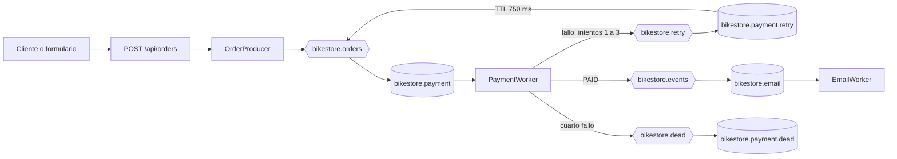

# BikeStore Async v1.0

Aplicación académica de pedidos de bicicletas con Java 17, Spring Boot 4.1.2 y RabbitMQ 4. El API acepta pedidos y responde de inmediato con un `pedidoId`; el pago y la confirmación de correo se simulan de forma asíncrona. No hay base de datos, cobros ni correos reales.

## Requisitos y arranque en Windows

- Java 17, Docker Desktop, PowerShell y Git.
- Puertos locales libres: 8080 para Spring Boot, 5672 para AMQP y 15672 para la administración de RabbitMQ.

```powershell
git clone https://github.com/Juliomm8/bikestore-async.git
Set-Location bikestore-async
Copy-Item .env.example .env
```

Edita `.env` y reemplaza la contraseña de ejemplo por una clave local. El archivo `.env` está ignorado por Git. Inicia exclusivamente el servicio RabbitMQ de este proyecto:

```powershell
docker compose up -d rabbitmq
docker compose ps
```

Desde una terminal PowerShell abierta en la raíz del proyecto, inicia Spring Boot. La aplicación importa `.env` automáticamente y conecta a RabbitMQ mediante `127.0.0.1:5672`; no necesitas exportar variables en la terminal:

```powershell
.\mvnw.cmd spring-boot:run
```

Abre [http://localhost:8080/](http://localhost:8080/) para usar el formulario. El panel de RabbitMQ está en [http://localhost:15672/](http://localhost:15672/); utiliza las credenciales locales de `.env`.

## Catálogo y formulario

La página principal es una tienda editorial con doce bicicletas ficticias de gravel, ruta, montaña y ciudad (catálogo en `static/js/catalog.js`). Puedes filtrar categorías y agregar modelos distintos al carrito, cambiar cantidades o quitar líneas; el subtotal y el total se actualizan automáticamente. Al confirmar, el navegador envía un solo pedido con varios artículos. La página muestra el `pedidoId`, el total aceptado por el servidor y recuerda que el pago continúa de forma asíncrona. Las fotografías WebP se sirven desde el proyecto; su procedencia está en [docs/IMAGENES.md](docs/IMAGENES.md).

Este catálogo es una demostración académica. Los precios ficticios se mantienen en el catálogo inmutable de `CatalogPriceService`; el backend calcula el total y no confía en importes enviados desde el navegador. La pantalla muestra el total estimado con los mismos precios para que el cliente pueda revisar el pedido antes de confirmarlo.

## API

`POST /api/orders` recibe JSON con una lista de artículos. Un pedido válido responde `202 Accepted` y un solo `pedidoId`:

```json
{
  "customerEmail": "ana@example.com",
  "items": [
    { "bikeModel": "Alerce", "quantity": 2 },
    { "bikeModel": "Ruta Clara", "quantity": 1 }
  ]
}
```

```json
{
  "pedidoId": "46513cc1-0b3a-4cbb-a18d-a9f64a5ca7e5",
  "status": "ACCEPTED",
  "total": 4170.00
}
```

`customerEmail` debe ser un correo válido; cada `bikeModel` debe existir en el catálogo del servidor y cada `quantity` debe estar entre 1 y 99. La lista acepta hasta 12 líneas y los artículos repetidos se combinan. Los datos inválidos reciben HTTP `400`. `ACCEPTED` significa que RabbitMQ confirmó la publicación, no que el pago haya terminado.

Por compatibilidad, el API también acepta el formato anterior de un artículo (`bikeModel`, `quantity` y `unitPrice`), pero siempre ignora el precio recibido y toma el importe del catálogo del servidor. El formulario actual no envía precios.

Ejemplo desde PowerShell:

```powershell
$body = @{
    customerEmail = 'ana@example.com'
    items = @(
        @{ bikeModel = 'Alerce'; quantity = 2 },
        @{ bikeModel = 'Ruta Clara'; quantity = 1 }
    )
} | ConvertTo-Json
Invoke-RestMethod -Uri 'http://localhost:8080/api/orders' -Method Post -ContentType 'application/json' -Body $body
```

## Arquitectura



Las colas son duraderas y los mensajes JSON persistentes. El API genera un identificador y publica una sola `OrderMessage` con todos los artículos y el total calculado en el servidor. `PaymentWorker` procesa el carrito completo como una operación y utiliza una decisión aleatoria de 50 % de éxito por intento en la aplicación normal. Una cabecera `failedAttempts` limita el flujo a un intento inicial y tres reintentos adicionales. La cola de reintento espera 750 ms y usa un dead-letter exchange para devolver el mensaje a pagos. Al cuarto fallo se publica en la DLQ un JSON `FailedPayment` con el pedido completo, cuatro intentos, motivo y fecha. La cola de pagos también tiene un dead-letter exchange para mensajes inválidos rechazados.

`EmailWorker` consume una cola diferente, alimentada por el evento `payment.paid`. Comprueba `paymentStatus=PAID` antes de simular el correo e incluye un resumen de modelos, cantidades y total. Dos trabajadores en la misma cola competirían por los mensajes, por lo que el correo depende del evento posterior al pago. Las excepciones de publicación pueden producir una nueva entrega; al no existir almacenamiento de idempotencia en esta versión académica, un fallo de confirmación excepcional podría repetir una simulación.

| Exchange | Routing key | Cola | Uso |
| --- | --- | --- | --- |
| `bikestore.orders` | `payment.requested` | `bikestore.payment` | Pedidos pendientes de pago |
| `bikestore.retry` | `payment.retry` | `bikestore.payment.retry` | Espera de 750 ms antes de otro intento |
| `bikestore.events` | `payment.paid` | `bikestore.email` | Confirmaciones después del pago |
| `bikestore.dead` | `payment.failed` | `bikestore.payment.dead` | Fallos definitivos y mensajes rechazados |

Los registros de negocio usan siempre `pedidoId`, `timestamp` UTC, `thread`, `evento` y `detalle`. El `pedidoId` permite seguir un pedido entre el API y ambos consumidores.

## Pruebas

Las pruebas unitarias deterministas cubren el contrato REST, el precio autoritativo, el mensaje único del carrito, el pago exitoso, los reintentos, la DLQ y la notificación de correo. Para ejecutarlas sin iniciar una aplicación en el puerto 8080:

```powershell
.\mvnw.cmd -q "-Dtest=OrderControllerMvcTest,OrderControllerTest,OrderSubmissionServiceTest,OrderProducerTest,PaymentWorkerTest,EmailWorkerTest,OrderEventLoggerTest,AssetCacheFilterTest" test
.\mvnw.cmd -q -DskipTests package
```

Las pruebas de integración adicionales usan RabbitMQ real y algunas vacían las colas de BikeStore. Ejecútalas únicamente con la aplicación detenida, las colas sin pedidos pendientes y sin otros consumidores activos:

```powershell
.\mvnw.cmd test
.\mvnw.cmd package
docker exec bikestore-rabbitmq rabbitmqctl list_queues name messages arguments
```

Las pruebas sustituyen la decisión aleatoria por resultados deterministas. `PaymentIntegrationTest` crea temporalmente una cola de auditoría para comprobar los eventos `PAID` y limpia las colas de BikeStore al preparar cada escenario. Consulta [docs/PRUEBAS.md](docs/PRUEBAS.md) para distinguir los escenarios ejecutados de los que se dejaron sin ejecutar por seguridad del broker.

## Recursos estáticos y caché

Las fotografías locales se sirven en WebP y las URL de CSS, JavaScript, fuentes e imágenes llevan la versión `BIKESTORE_ASSET_VERSION` definida en `static/index.html`. Cuando se cambie un recurso estático, actualiza esa versión también en las URL de fuentes de `static/css/store.css`. El filtro `AssetCacheFilter` sirve los recursos versionados con un año de caché inmutable; los archivos sin versión deben revalidarse y el HTML no se guarda en caché. Las respuestas de `/api/**` usan `private, no-store` para no conservar pedidos ni operaciones. Las mediciones antes/después están en [docs/PRUEBAS.md](docs/PRUEBAS.md).

Si existe una cola `bikestore.payment` creada con una versión anterior sin dead-letter exchange, RabbitMQ rechazará cambiar sus argumentos en caliente. Antes de migrarla, inspecciona sus mensajes y procesa o conserva cualquier pedido pendiente; solo cuando esté vacía se puede eliminar esa cola específica para que la aplicación la declare de nuevo.
