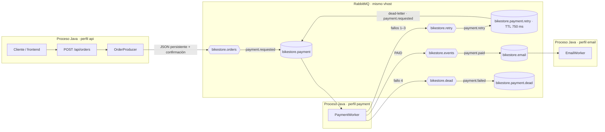

# BikeStore Async v1.0

Aplicación académica de pedidos de bicicletas con Java 17, Spring Boot 4.1.2 y RabbitMQ 4. El API acepta pedidos y responde de inmediato con un `pedidoId`; el pago y la confirmación de correo se simulan de forma asíncrona. No hay base de datos, cobros ni correos reales.

> **[Abrir la demostración visual en GitHub Pages](https://juliomm8.github.io/bikestore-async/)**
>
> Pages publica únicamente la tienda estática: puedes recorrer el catálogo, filtrar, abrir fichas y usar una bolsa local que se guarda en este navegador. No envía pedidos ni genera `pedidoId`; el procesamiento asíncrono requiere ejecutar la aplicación y RabbitMQ con los pasos siguientes. Consulta la [arquitectura](docs/DEMOSTRACION.md) y los [resultados de pruebas](docs/PRUEBAS.md).

## Requisitos y arranque en Windows

- Java 17, Docker Desktop, PowerShell y Git.
- Puertos locales libres: 8080 para Spring Boot, 5672 para AMQP y 15672 para la administración de RabbitMQ.

```powershell
git clone https://github.com/Juliomm8/bikestore-async.git
Set-Location bikestore-async
Copy-Item .env.example .env
```

Edita `.env` y reemplaza la contraseña de ejemplo por una clave local. El archivo `.env` está ignorado por Git. Inicia exclusivamente el servicio RabbitMQ de este proyecto:

```powershell
docker compose up -d rabbitmq
docker compose ps
```

Desde una terminal PowerShell abierta en la raíz del proyecto, inicia Spring Boot. La aplicación importa `.env` automáticamente y conecta a RabbitMQ mediante `127.0.0.1:5672`; no necesitas exportar variables en la terminal:

```powershell
.\mvnw.cmd spring-boot:run
```

Abre [http://localhost:8080/](http://localhost:8080/) para usar el formulario. El panel de RabbitMQ está en [http://localhost:15672/](http://localhost:15672/); utiliza las credenciales locales de `.env`.

## Catálogo y formulario

La página principal es una tienda editorial con doce bicicletas ficticias de gravel, ruta, montaña y ciudad (catálogo en `static/js/catalog.js`). Puedes filtrar categorías y agregar modelos distintos al carrito, cambiar cantidades o quitar líneas; el subtotal y el total se actualizan automáticamente. Al confirmar, el navegador envía un solo pedido con varios artículos. La página muestra el `pedidoId`, el total aceptado por el servidor y recuerda que el pago continúa de forma asíncrona. Las fotografías WebP se sirven desde el proyecto; su procedencia está en [docs/IMAGENES.md](docs/IMAGENES.md).

Este catálogo es una demostración académica. Los precios ficticios se mantienen en el catálogo inmutable de `CatalogPriceService`; el backend calcula el total y no confía en importes enviados desde el navegador. La pantalla muestra el total estimado con los mismos precios para que el cliente pueda revisar el pedido antes de confirmarlo.

### Tema, bolsa y fichas rápidas

La barra superior incluye el cambio de tema y la bolsa. En la primera visita, el tema sigue `prefers-color-scheme`; el selector se aplica antes de cargar la hoja de estilos, para evitar un destello del tema contrario. La preferencia manual se recuerda en `localStorage` (`bikestore.theme`) y el sistema se sigue mientras no se elija un tema explícito.

La bolsa lateral permite editar cantidades, revisar subtotales, quitar modelos y continuar al formulario. Se conserva en `localStorage` únicamente el identificador del modelo y su cantidad (`bikestore.cart.v1`); al restaurar, los modelos se contrastan con el catálogo actual y los precios se vuelven a leer del servidor. La ficha rápida muestra una fotografía completa, descripción y características sin salir del catálogo. Los diálogos se pueden recorrer con teclado, cierran con `Escape`, contienen el foco y lo devuelven al control que los abrió. Las animaciones respetan `prefers-reduced-motion`.

Vistas verificadas en Chromium: [escritorio, tema claro](docs/evidencia/tema-claro-escritorio.jpg) y [móvil, tema oscuro](docs/evidencia/tema-oscuro-movil.jpg). El detalle de las comprobaciones está en [docs/PRUEBAS.md](docs/PRUEBAS.md).

## API

`POST /api/orders` recibe JSON con una lista de artículos. Un pedido válido responde `202 Accepted` y un solo `pedidoId`:

```json
{
  "customerEmail": "ana@example.com",
  "items": [
    { "bikeModel": "Alerce", "quantity": 2 },
    { "bikeModel": "Ruta Clara", "quantity": 1 }
  ]
}
```

```json
{
  "pedidoId": "46513cc1-0b3a-4cbb-a18d-a9f64a5ca7e5",
  "status": "ACCEPTED",
  "total": 4170.00
}
```

`customerEmail` debe ser un correo válido; cada `bikeModel` debe existir en el catálogo del servidor y cada `quantity` debe estar entre 1 y 99. La lista acepta hasta 12 líneas y los artículos repetidos se combinan. Los datos inválidos reciben HTTP `400`. `ACCEPTED` significa que RabbitMQ confirmó la publicación, no que el pago haya terminado.

Por compatibilidad, el API también acepta el formato anterior de un artículo (`bikeModel`, `quantity` y `unitPrice`), pero siempre ignora el precio recibido y toma el importe del catálogo del servidor. El formulario actual no envía precios.

Ejemplo desde PowerShell:

```powershell
$body = @{
    customerEmail = 'ana@example.com'
    items = @(
        @{ bikeModel = 'Alerce'; quantity = 2 },
        @{ bikeModel = 'Ruta Clara'; quantity = 1 }
    )
} | ConvertTo-Json
Invoke-RestMethod -Uri 'http://localhost:8080/api/orders' -Method Post -ContentType 'application/json' -Body $body
```

## Arquitectura



El JAR admite cuatro modos excluyentes. Si no se activa un perfil, `spring.profiles.default=integrated` conserva el modo de desarrollo existente: API y ambos consumidores en una JVM. Los perfiles `api`, `payment` y `email` cargan solo el rol indicado; payment y email configuran Spring sin servidor web. Una validación de arranque rechaza combinaciones de perfiles de rol.

### Ejecutar tres procesos en Windows

Inicia RabbitMQ de BikeStore y compila el JAR una sola vez:

```powershell
docker compose up -d rabbitmq
docker compose ps
.\mvnw.cmd -DskipTests package
```

Abre tres terminales PowerShell en la raíz del repositorio y ejecuta un comando en cada una:

```powershell
java -jar target\bikestore-async-0.0.1-SNAPSHOT.jar --spring.profiles.active=api
```

```powershell
java -jar target\bikestore-async-0.0.1-SNAPSHOT.jar --spring.profiles.active=payment
```

```powershell
java -jar target\bikestore-async-0.0.1-SNAPSHOT.jar --spring.profiles.active=email
```

El API atiende el puerto `8080`; los dos workers no abren puertos HTTP. Cada terminal inicia su propia JVM. Para detener un rol, pulsa `Ctrl+C` en su terminal. La conexión y las credenciales se leen de `.env`, importado desde la raíz; el perfil de cada terminal cambia únicamente sus componentes.

En RabbitMQ Management (`http://127.0.0.1:15672`), revisa **Connections** para ver las conexiones de los procesos y **Queues** para comprobar un consumidor en `bikestore.payment` y otro en `bikestore.email`. El perfil `api` abre su conexión al publicar el primer pedido; payment y email la abren al conectarse. Usa las credenciales locales de `.env`. Ejecuta el modo integrado o los tres procesos distribuidos en una sesión, no ambos a la vez.

### Exchanges, rutas y colas

| Exchange | Routing key | Cola | Uso |
| --- | --- | --- | --- |
| `bikestore.orders` | `payment.requested` | `bikestore.payment` | Pedidos pendientes de pago |
| `bikestore.retry` | `payment.retry` | `bikestore.payment.retry` | Espera de 750 ms antes de otro intento |
| `bikestore.events` | `payment.paid` | `bikestore.email` | Confirmaciones después del pago |
| `bikestore.dead` | `payment.failed` | `bikestore.payment.dead` | Fallos definitivos y mensajes rechazados |

`OrderProducer` publica el JSON persistente con `messageId=pedidoId` y espera publisher confirms. `PaymentWorker` usa 50 % de probabilidad de aprobación por intento en los modos normales; `failedAttempts` limita el flujo a cuatro intentos totales. La cola retry espera 750 ms. Tras el cuarto fallo, el productor publica `FailedPayment` en la DLQ. Los listeners usan reconocimiento manual y reconocen el mensaje original después de confirmar la siguiente publicación. Como no hay almacenamiento de idempotencia, un fallo excepcional al confirmar una publicación podría producir una entrega repetida.

`EmailWorker` consume exclusivamente la cola del evento `payment.paid`; verifica `paymentStatus=PAID` antes de registrar el correo simulado y el resumen de bicicletas. Las colas duraderas conservan pedidos mientras un proceso worker está detenido. Si PaymentWorker no está disponible, la API aún puede confirmar la publicación `202` y RabbitMQ mantiene el pedido en `bikestore.payment`. Si EmailWorker no está disponible, el pago puede terminar como `PAID` y la confirmación permanece en `bikestore.email`; al reiniciarlo, continúa desde esa cola. Todos los eventos incluyen `pedidoId`, `timestamp`, `thread`, evento y detalle.

### Pruebas y evidencia

Pruebas unitarias deterministas (sin iniciar la aplicación en `8080`):

```powershell
.\mvnw.cmd -q "-Dtest=ProcessProfileValidatorTest,OrderProducerTest,PaymentWorkerTest,EmailWorkerTest,OrderEventLoggerTest,OrderSubmissionServiceTest,OrderControllerMvcTest,OrderControllerTest,AssetCacheFilterTest" test
```

Prueba reproducible de los procesos reales. Requiere compilar primero el JAR; usa solo `bikestore-evaluation-demo`, verifica el vhost y que sus colas estén vacías, inicia y detiene únicamente los PID que creó:

```powershell
.\scripts\Test-ProcesosIndependientes.ps1
```

Para los escenarios RabbitMQ con decisiones deterministas en el contexto de pruebas:

```powershell
.\scripts\Run-RabbitMqDemostracion.ps1
```

Las dos pruebas de integración confirman el vhost antes de operar. Los scripts abortan si encuentran trabajo o consumidores previos en el vhost de evaluación; nunca purgan el vhost principal. Consulta [docs/DEMOSTRACION.md](docs/DEMOSTRACION.md) para el flujo por proceso, los resultados de tolerancia a fallos y los artefactos capturados, y [docs/PRUEBAS.md](docs/PRUEBAS.md) para los comandos y resultados observados.

## Pruebas

Las pruebas unitarias deterministas cubren el contrato REST, el precio autoritativo, el mensaje único del carrito, el pago exitoso, los reintentos, la DLQ y la notificación de correo. Para ejecutarlas sin iniciar una aplicación en el puerto 8080:

```powershell
.\mvnw.cmd -q "-Dtest=ProcessProfileValidatorTest,OrderControllerMvcTest,OrderControllerTest,OrderSubmissionServiceTest,OrderProducerTest,PaymentWorkerTest,EmailWorkerTest,OrderEventLoggerTest,AssetCacheFilterTest" test
.\mvnw.cmd -q -DskipTests package
```

Para demostrar el flujo completo con RabbitMQ real sin tocar el vhost principal, usa el runner aislado:

```powershell
.\scripts\Run-RabbitMqDemostracion.ps1
```

El runner verifica que las colas del vhost `bikestore-evaluation-demo` no tengan mensajes ni consumidores, y fija ese vhost en las pruebas que preparan escenarios de pago. No purga colas del vhost principal. Consulta [docs/DEMOSTRACION.md](docs/DEMOSTRACION.md) para el diagrama, la ejecución por procesos y los resultados; los resultados acumulados están en [docs/PRUEBAS.md](docs/PRUEBAS.md).

## Recursos estáticos y caché

Las fotografías locales se sirven en WebP y las URL de CSS, JavaScript, fuentes e imágenes llevan la versión `BIKESTORE_ASSET_VERSION` definida en `static/index.html`. Cuando se cambie un recurso estático, actualiza esa versión también en las URL de fuentes de `static/css/store.css`. El filtro `AssetCacheFilter` sirve los recursos versionados con un año de caché inmutable; los archivos sin versión deben revalidarse y el HTML no se guarda en caché. Las respuestas de `/api/**` usan `private, no-store` para no conservar pedidos ni operaciones. Las mediciones antes/después están en [docs/PRUEBAS.md](docs/PRUEBAS.md).

Si existe una cola `bikestore.payment` creada con una versión anterior sin dead-letter exchange, RabbitMQ rechazará cambiar sus argumentos en caliente. Antes de migrarla, inspecciona sus mensajes y procesa o conserva cualquier pedido pendiente; solo cuando esté vacía se puede eliminar esa cola específica para que la aplicación la declare de nuevo.
