# BikeStore Async v1.0

**Informe técnico breve — Diseño y Arquitectura de Software**

> **Demostración visual:** [juliomm8.github.io/bikestore-async](https://juliomm8.github.io/bikestore-async/) 
> La página de GitHub Pages publica solo el frontend estático. No ejecuta Java, RabbitMQ ni el endpoint de pedidos. Para comprobar el flujo asíncrono se debe iniciar el backend localmente.

[Arquitectura y resultados de integración](docs/DEMOSTRACION.md) · [Pruebas y evidencia](docs/PRUEBAS.md) · [Fuentes de imágenes](docs/IMAGENES.md) · [Historial de CI](https://github.com/Juliomm8/bikestore-async/actions/workflows/ci.yml)

## 1. Contexto académico y objetivo

BikeStore Async se desarrolló para el deber de **Diseño y Arquitectura de Software**. El objetivo académico es recibir un pedido por una API, publicarlo como un mensaje JSON persistente en RabbitMQ y procesarlo de forma asíncrona mediante dos responsabilidades independientes: el pago simulado y la confirmación de correo simulada.

La entrega permite revisar el flujo con RabbitMQ real, observar los reintentos y la Dead-Letter Queue (DLQ), y ejecutar la API y cada consumidor en procesos Java distintos. Se conserva también el modo integrado de desarrollo para compatibilidad y pruebas locales.

## 2. Resumen del sistema

El cliente envía un pedido con uno o varios modelos de bicicleta. La API valida el correo, los modelos y las cantidades; obtiene los precios oficiales del catálogo del servidor; crea un identificador único de pedido; y solicita a OrderProducer la publicación del JSON. La respuesta HTTP 202 confirma que el mensaje fue aceptado por RabbitMQ, no que el pago ya haya terminado.

PaymentWorker simula el cobro con una probabilidad de fallo del 50 % en cada intento. Tras el intento inicial admite tres reintentos adicionales. Si el pago queda aprobado, publica el evento payment.paid; EmailWorker consume ese evento y registra una confirmación simulada. Si se agotan los cuatro intentos, el detalle del fallo llega a la DLQ. No se usan cobros, correo SMTP ni servicios comerciales reales.

El proyecto usa Java 17, Spring Boot 4.1.2, Maven y RabbitMQ 4. No requiere base de datos.

## 3. Correspondencia entre el enunciado y la implementación

| Requisito académico | Implementación | Evidencia para revisar |
| --- | --- | --- |
| Recibir pedidos mediante un API REST | POST /api/orders, validación del cuerpo y respuesta HTTP 202 con un solo pedidoId | [Contrato y pruebas](docs/PRUEBAS.md), [captura de confirmación](docs/capturas/pedido-aceptado-frontend.jpg), [registro de HTTP 202](docs/capturas/pedido-aceptado.jpg) |
| Publicar un mensaje JSON en RabbitMQ | OrderProducer publica JSON persistente con confirmación del broker | [OrderProducer](src/main/java/com/bikestore/asyncapp/messaging/OrderProducer.java), [eventos y colas probados](docs/DEMOSTRACION.md) |
| Simular fallos y reintentar el pago | RandomPaymentDecision conserva el 50 % por intento; PaymentWorker realiza un intento inicial y hasta tres adicionales | [PaymentWorker](src/main/java/com/bikestore/asyncapp/payment/PaymentWorker.java), [resultados de pruebas](docs/PRUEBAS.md) |
| Enviar a DLQ al agotar los intentos | El fallo final conserva pedidoId, intentos y motivo en bikestore.payment.dead | [mensaje de DLQ](docs/capturas/mensaje-dlq.jpg), [pruebas de integración](docs/DEMOSTRACION.md) |
| Confirmar solo pagos aprobados | EmailWorker consume payment.paid y valida paymentStatus=PAID; el emisor es simulado | [EmailWorker](src/main/java/com/bikestore/asyncapp/email/EmailWorker.java), [logs](docs/capturas/logs-trazabilidad.jpg) |
| Registrar trazabilidad | Los eventos incluyen pedidoId, timestamp, thread, nombre de evento y detalle | [captura de logs](docs/capturas/logs-trazabilidad.jpg), [archivo de eventos](docs/evidencia/demostracion/20261031-184253/mensajes-y-eventos.log) |
| Separar API y consumidores | El mismo JAR ofrece perfiles api, payment y email; cada rol puede ejecutarse con un PID propio. El perfil integrado conserva el arranque anterior | [prueba de procesos](docs/DEMOSTRACION.md), [captura de procesos](docs/capturas/procesos-independientes.jpg) |
| Mostrar la tienda sin desplegar el backend | GitHub Pages sirve el catálogo y el carrito local, pero no envía pedidos ni inventa identificadores o pagos | [demo estática](https://juliomm8.github.io/bikestore-async/), [verificación](docs/PRUEBAS.md) |

## 4. Arquitectura general

~~~mermaid
flowchart LR
    Browser["Navegador tienda y formulario"] -->|POST /api/orders| API["Proceso Java API OrderController"]
    API --> Submission["OrderSubmissionService validación y precios oficiales"]
    Submission --> Producer["OrderProducer JSON persistente y publisher confirm"]

    subgraph RabbitMQ["RabbitMQ · vhost configurado"]
        OrdersX{{"bikestore.orders"}}
        PaymentQ[("bikestore.payment")]
        RetryX{{"bikestore.retry"}}
        RetryQ[("bikestore.payment.retry TTL 750 ms")]
        EventsX{{"bikestore.events"}}
        EmailQ[("bikestore.email")]
        DeadX{{"bikestore.dead"}}
        DeadQ[("bikestore.payment.dead")]
        OrdersX --> PaymentQ
        RetryX --> RetryQ
        RetryQ -->|TTL cumplido| OrdersX
        EventsX --> EmailQ
        DeadX --> DeadQ
    end

    Producer -->|payment.requested| OrdersX
    PaymentQ --> Payment["Proceso Java Payment PaymentWorker"]
    Payment -->|payment.retry| RetryX
    Payment -->|payment.paid| EventsX
    Payment -->|payment.failed| DeadX
    EmailQ --> Email["Proceso Java Email EmailWorker"]
~~~

Los tres roles pueden conectarse al mismo broker y vhost. En modo distribuido se ejecutan como procesos del sistema operativo distintos; el intercambio entre ellos ocurre mediante RabbitMQ, no mediante llamadas directas entre JVM.

### Separación en tres procesos Java

~~~mermaid
flowchart LR
    subgraph APIProcess["Proceso Java · perfil api · PID propio"]
        Web["Frontend y API REST"] --> Producer["OrderProducer"]
    end
    subgraph PaymentProcess["Proceso Java · perfil payment · PID propio"]
        Payment["PaymentWorker"]
    end
    subgraph EmailProcess["Proceso Java · perfil email · PID propio"]
        Email["EmailWorker"]
    end
    subgraph Broker["RabbitMQ"]
        PaymentQueue[("bikestore.payment")]
        EmailQueue[("bikestore.email")]
        OrdersExchange{{"bikestore.orders"}}
        EventsExchange{{"bikestore.events"}}
        OrdersExchange --> PaymentQueue
        EventsExchange --> EmailQueue
    end
    Producer --> OrdersExchange
    PaymentQueue --> Payment
    Payment --> EventsExchange
    EmailQueue --> Email
~~~

Cada proceso carga solo su perfil. En modo integrado, los mismos componentes pueden convivir en una sola JVM durante el desarrollo local.

### Exchanges, routing keys y colas

Los exchanges son directos y duraderos; las colas son duraderas. Las rutas vigentes se declaran en RabbitTopology:

| Exchange | Routing key | Cola destino | Uso y configuración relevante |
| --- | --- | --- | --- |
| bikestore.orders | payment.requested | bikestore.payment | Pedido que espera el procesamiento del pago |
| bikestore.retry | payment.retry | bikestore.payment.retry | Espera 750 ms y vuelve a bikestore.orders con payment.requested |
| bikestore.events | payment.paid | bikestore.email | Evento de pago aprobado que procesa EmailWorker |
| bikestore.dead | payment.failed | bikestore.payment.dead | Fallo definitivo y mensajes rechazados sin reencolar |

## 5. Componentes principales

| Componente | Responsabilidad |
| --- | --- |
| OrderController y OrderSubmissionService | Reciben y validan la solicitud, calculan el pedido con precios del servidor y devuelven el resultado de aceptación |
| CatalogPriceService | Mantiene la lista académica de modelos y precios autorizados por el backend |
| OrderProducer y ConfirmedPublisher | Serializan y publican el mensaje persistente, y verifican la confirmación de RabbitMQ |
| RabbitTopology | Declara exchanges directos, colas duraderas, bindings, TTL y rutas de dead-letter |
| PaymentWorker | Simula el pago, decide el resultado por intento y publica el evento correspondiente |
| RandomPaymentDecision | Provee la decisión aleatoria del 50 % usada en ejecución normal |
| EvaluationPaymentConfiguration | Provee decisiones deterministas para las pruebas aisladas |
| EmailWorker y SimulatedEmailSender | Procesan únicamente pagos PAID y registran una confirmación sin conectarse a SMTP |
| ProcessProfileValidator | Evita activar a la vez perfiles de rol incompatibles |
| AssetCacheFilter | Define políticas de caché HTTP para recursos estáticos versionados |
| Frontend estático | Catálogo de demostración, filtros, fichas, tema claro/oscuro y carrito en HTML, CSS y JavaScript |

El detalle de paquetes y responsabilidades se puede seguir desde los enlaces de la tabla y desde src/main/java/com/bikestore/asyncapp/.

## 6. Flujo de procesamiento de un pedido

~~~mermaid
sequenceDiagram
    actor Cliente
    participant API as API / OrderProducer
    participant Broker as RabbitMQ
    participant Payment as PaymentWorker
    participant Email as EmailWorker

    Cliente->>API: POST /api/orders
    API->>API: Validar datos y resolver precios oficiales
    API->>Broker: JSON persistente · payment.requested
    Broker-->>API: Publisher confirm
    API-->>Cliente: HTTP 202 + pedidoId

    Broker->>Payment: Entrega desde bikestore.payment
    Payment->>Payment: Simula un intento de pago
    alt Pago PAID
        Payment->>Broker: Publicar payment.paid
        Payment->>Broker: ACK del pedido procesado
        Broker->>Email: Entrega desde bikestore.email
        Email->>Email: Validar PAID y simular confirmación
        Email->>Broker: ACK del evento
    else Pago fallido y quedan reintentos
        Payment->>Broker: Enviar a bikestore.payment.retry
        Payment->>Broker: ACK del mensaje original
    else Se agotaron los cuatro intentos
        Payment->>Broker: Publicar FailedPayment en la DLQ
        Payment->>Broker: ACK del mensaje original
    end
~~~

La respuesta 202 representa aceptación del mensaje por el broker. El estado final se observa después en los logs y en el evento de pago o la DLQ.

## 7. Reintentos y Dead-Letter Queue

~~~mermaid
flowchart TD
    A["bikestore.payment intento actual"] --> B{"Resultado de pago"}
    B -->|Aprobado| C["Publicar payment.paid"]
    C --> D["bikestore.email"]

    B -->|Fallido, intento 1 a 3| E["bikestore.retry payment.retry"]
    E --> F["bikestore.payment.retry TTL 750 ms"]
    F -->|Vencimiento| A

    B -->|Fallido en intento 4| G["Publicar payment.failed"]
    G --> H["bikestore.payment.dead"]
~~~

El mecanismo tiene un límite explícito: cuatro intentos en total (uno inicial y tres adicionales). La cola de reintento espera 750 ms antes de devolver el mensaje a la ruta de pago. Después del cuarto fallo se conserva un mensaje FailedPayment con el identificador del pedido, el número de intentos y el motivo. El pedido fallido no produce payment.paid y, por tanto, no genera una confirmación de correo.

La probabilidad del 50 % corresponde a cada intento en la ejecución normal. Las pruebas usan decisiones deterministas para verificar los distintos resultados sin depender del azar.

## 8. Decisiones de arquitectura y justificación

**RabbitMQ para desacoplar productores y consumidores.** La API no espera a que terminen el cobro simulado ni la confirmación de correo. Publica el pedido y responde cuando el broker confirma el mensaje. Esto permite que un worker esté detenido temporalmente sin bloquear la recepción de pedidos; las colas duraderas conservan los mensajes hasta que el consumidor vuelva.

**Pago y correo como responsabilidades distintas.** Pago y correo tienen ritmos, errores y condiciones de ejecución diferentes. PaymentWorker comunica el éxito mediante payment.paid; EmailWorker consume ese evento desde otra cola. Si ambos compartieran una sola cola, competirían por los mismos mensajes y el correo podría no recibir el resultado del pago. La cola separada evita esa ambigüedad.

**Reintentos acotados y DLQ.** Un error transitorio puede resolverse en otro intento, pero repetir indefinidamente generaría ciclos y ocultaría fallos permanentes. El TTL en la cola de reintento regula la pausa, el máximo de cuatro intentos pone un límite y la DLQ conserva fallos para inspección sin devolverlos al flujo normal.

**ACK manual y publisher confirms.** Los confirms permiten a la API comprobar la aceptación de publicación; el ACK manual permite reconocer un mensaje de entrada después de que el worker complete el paso correspondiente. Para un reintento, primero se publica la copia en la ruta de espera y después se reconoce el mensaje original. Este diseño evita reconocer silenciosamente el original si falla su republicación. Como no hay base de datos ni almacén de idempotencia, la solución académica no promete entrega exactamente una vez ante todos los fallos de red.

**Precio autoritativo en el backend.** El navegador usa el catálogo JavaScript para mostrar precios estimados y mantener el carrito. Esos valores se pueden modificar desde el cliente, por lo que no se consideran confiables. Al recibir el pedido, CatalogPriceService valida cada modelo y calcula el total oficial en el servidor; no se agrega una base de datos para este catálogo académico.

**Un JAR y perfiles para tres procesos.** Los perfiles api, payment y email seleccionan los componentes de un rol y permiten ejecutarlos con PID independientes, sin crear tres proyectos o servicios innecesarios. El perfil integrado permanece como opción local compatible, aunque sus consumidores comparten JVM con la API.

**GitHub Pages como vista estática.** Pages publica los archivos de src/main/resources/static y permite revisar el diseño sin instalar Java o RabbitMQ. Al ser alojamiento estático, no puede ejecutar el endpoint; por seguridad y honestidad, el frontend publicado no envía pedidos ni presenta un pedidoId, pago o correo ficticio como resultado real.

## 9. API de pedidos

### Solicitud

~~~http
POST /api/orders
Content-Type: application/json
~~~

~~~json
{
  "customerEmail": "ciclista@example.test",
  "items": [
    {
      "bikeModel": "Alerce",
      "quantity": 1
    },
    {
      "bikeModel": "Ruta Clara",
      "quantity": 2
    }
  ]
}
~~~

El servidor valida el correo, las líneas, los modelos y las cantidades. Resuelve los precios desde su propio catálogo; cualquier precio enviado por el navegador no es la fuente de verdad.

### Respuesta

Una solicitud válida se responde con HTTP 202 Accepted y un pedidoId único para todos los artículos. La aceptación indica que el pedido quedó publicado para procesamiento asíncrono; el pago puede resolverse después. Las solicitudes inválidas reciben HTTP 400 con errores de validación.

## 10. Ejecución local: modo integrado

Requisitos: Git, Java 17, Docker Desktop y PowerShell. Desde una terminal en Windows:

~~~powershell
git clone https://github.com/Juliomm8/bikestore-async.git
Set-Location bikestore-async

Copy-Item .env.example .env
# Completar localmente las variables necesarias; no publicar .env.

docker compose up -d rabbitmq
docker compose ps

.\mvnw.cmd spring-boot:run
~~~

Spring Boot carga el .env local y usa 127.0.0.1 como host predeterminado de RabbitMQ. El comando spring-boot:run activa el modo integrado por defecto: API, PaymentWorker y EmailWorker en una sola JVM. La tienda queda disponible en http://localhost:8080/; RabbitMQ Management se consulta en http://127.0.0.1:15672/.

El archivo .env está excluido de Git. La plantilla .env.example documenta los nombres de configuración, pero no contiene credenciales reales.

## 11. Ejecución local: tres procesos Java

El modo distribuido mantiene un único proyecto Maven y JAR. Primero genera el ejecutable una vez:

~~~powershell
.\mvnw.cmd -DskipTests package
~~~

Abre tres terminales PowerShell en la raíz del repositorio. Inicia una función distinta en cada terminal:

~~~powershell
# Terminal 1: API, frontend y productor; puerto 8080
java -jar target\bikestore-async-0.0.1-SNAPSHOT.jar --spring.profiles.active=api
~~~

~~~powershell
# Terminal 2: solo PaymentWorker; no inicia servidor web
java -jar target\bikestore-async-0.0.1-SNAPSHOT.jar --spring.profiles.active=payment
~~~

~~~powershell
# Terminal 3: solo EmailWorker; no inicia servidor web
java -jar target\bikestore-async-0.0.1-SNAPSHOT.jar --spring.profiles.active=email
~~~

Cada terminal aloja un proceso Java independiente. El worker de pago y el worker de correo no ocupan el puerto 8080. Se detiene cada uno con Ctrl+C en su propia terminal; detener un proceso no detiene los otros.

Si el archivo JAR de target está bloqueado por una instancia existente en Windows, el empaquetado alternativo crea otra copia sin reemplazarlo:

~~~powershell
.\mvnw.cmd -Pempaquetado-alternativo -DskipTests package
java -jar target\empaquetado-alternativo\bikestore-async-0.0.1-SNAPSHOT.jar --spring.profiles.active=api
~~~

Ese perfil de Maven solo cambia la ruta de salida del artefacto; la compilación normal conserva target como destino.

En RabbitMQ Management, revisa **Connections** para las conexiones y **Queues** para los consumidores de bikestore.payment y bikestore.email. La API abre su conexión al publicar el primer pedido; los workers la abren al iniciar. Se debe ejecutar el modo integrado **o** los tres procesos, no ambos simultáneamente, porque consumidores conectados a una misma cola compiten por sus mensajes.

El modo integrado sigue disponible con .\mvnw.cmd spring-boot:run; los perfiles distribuidos son una forma adicional de demostrar independencia.

## 12. GitHub Pages: demostración visual estática

La [demostración online](https://juliomm8.github.io/bikestore-async/) permite revisar el catálogo, filtrar categorías, abrir fichas rápidas, cambiar el tema y modificar un carrito guardado en localStorage. Los precios y el total que muestra esa página son estimaciones visuales.

Pages no tiene el backend ni RabbitMQ. La confirmación del pedido se desactiva y no se generan identificadores, cobros, mensajes ni correos ficticios. El flujo completo requiere la aplicación local y el broker. La verificación pública y sus límites están descritos en [docs/PRUEBAS.md](docs/PRUEBAS.md).

## 13. Evidencia visual tomada en local

Las capturas siguientes se guardan en el repositorio y corresponden a la tienda local, RabbitMQ Management o a los archivos de evidencia de pruebas. Los datos de los ejemplos son académicos; no se incluyen contraseñas. Las capturas de Management ocultan el nombre de usuario. Las colas del vhost principal se documentan como una observación puntual: no fueron purgadas ni consumidas durante esta revisión. Los escenarios automatizados de RabbitMQ se aislaron en bikestore-evaluation-demo.

### Frontend

  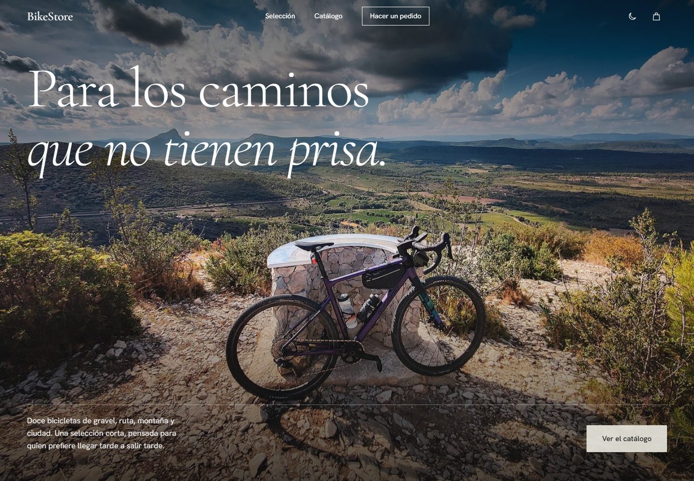

<em>Figura 1. Página principal local con la composición editorial de la tienda.</em>

  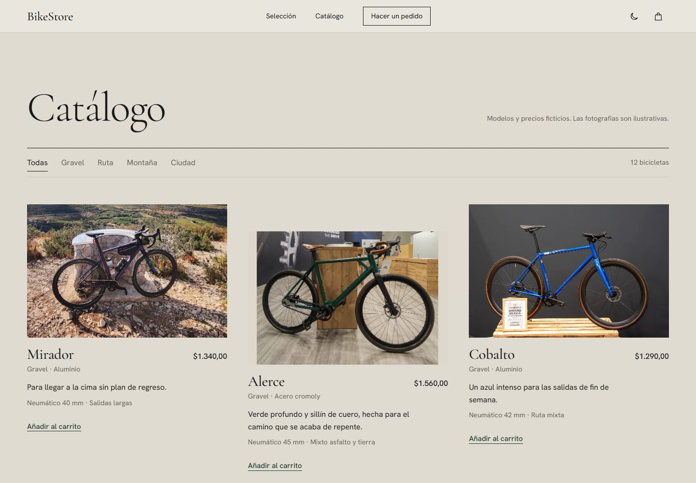

<em>Figura 2. Catálogo local con sus modelos y filtros.</em>

  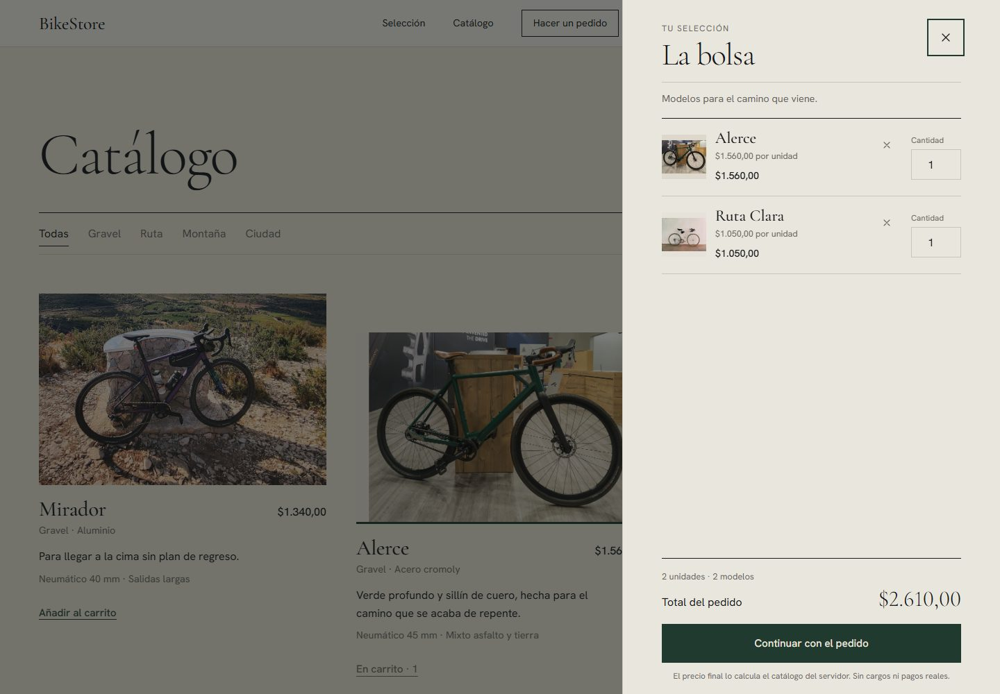

<em>Figura 3. Carrito lateral en escritorio.</em>

  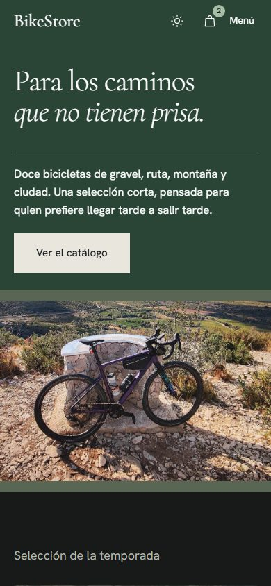

<em>Figura 4. Presentación móvil con tema oscuro.</em>

  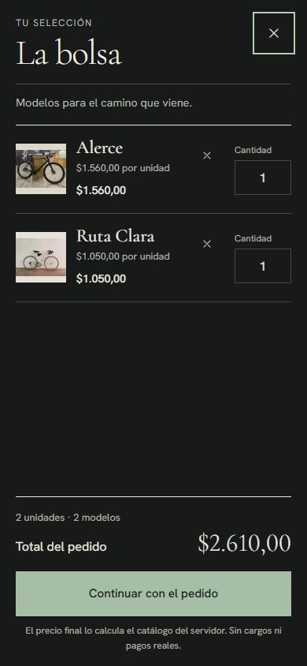

<em>Figura 5. Carrito adaptado a móvil.</em>

  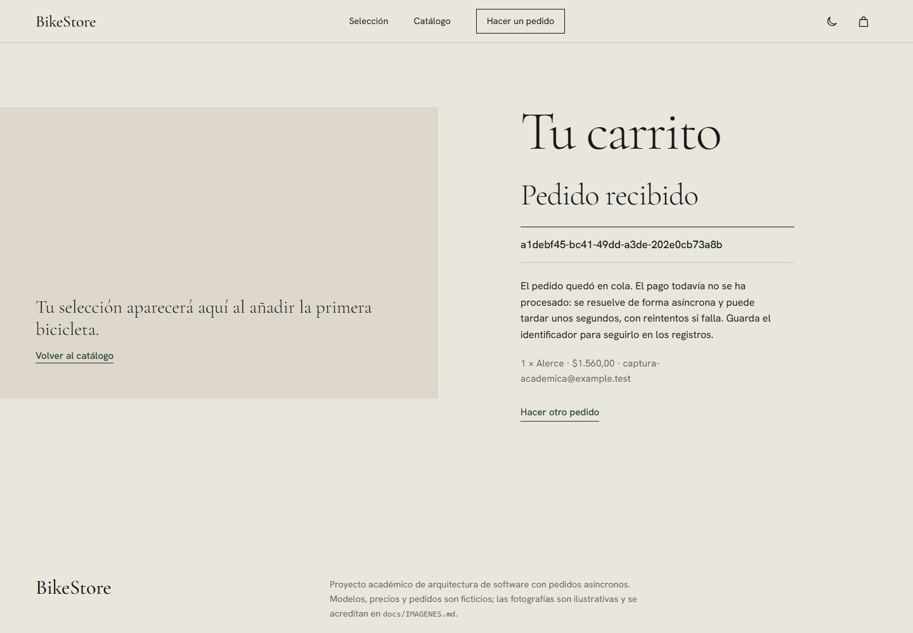

<em>Figura 6. Confirmación de aceptación recibida desde la API local. La pantalla indica que el pago sigue procesándose de forma asíncrona; el resultado posterior se verificó en los logs.</em>

### RabbitMQ, reintentos y DLQ

  
Ver capturas de RabbitMQ Management y mensajes de prueba

  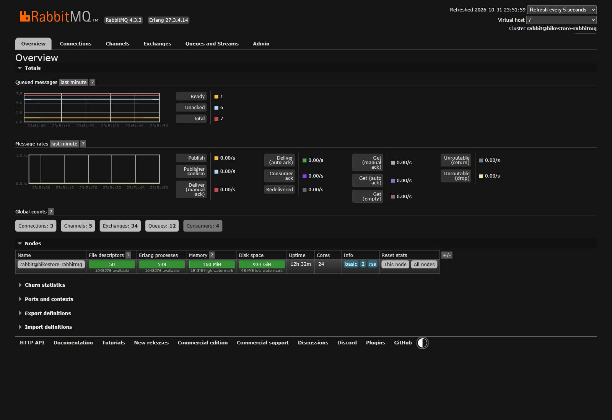

<em>Figura 7. Panel de RabbitMQ Management conectado al contenedor de BikeStore.</em>

  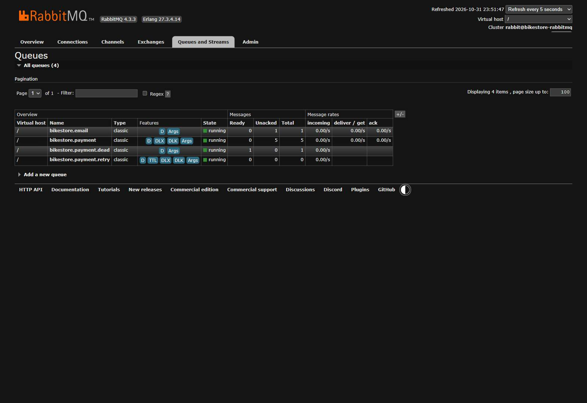

<em>Figura 8. Snapshot de las colas en el vhost principal. En la captura había cinco mensajes sin reconocer en pago, uno sin reconocer en correo, uno listo en la DLQ y ninguno en reintentos. Se dejó el estado intacto.</em>

  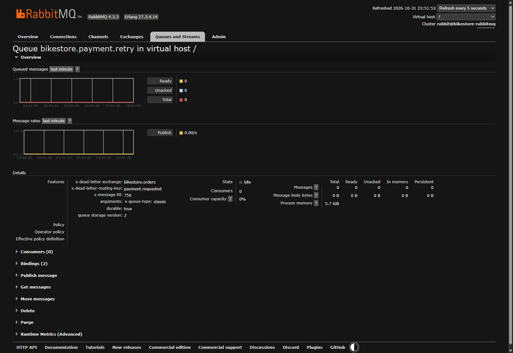

<em>Figura 9. Cola de reintentos con TTL de 750 ms y retorno a la ruta de pago; no había mensajes en espera al capturarla.</em>

  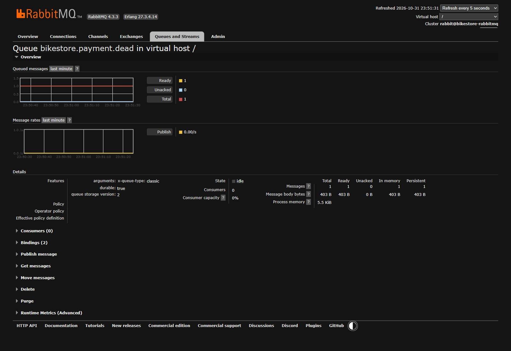

<em>Figura 10. La DLQ principal conservaba un mensaje listo. La captura muestra el conteo; no se recuperó ni se reconoció ese mensaje.</em>

  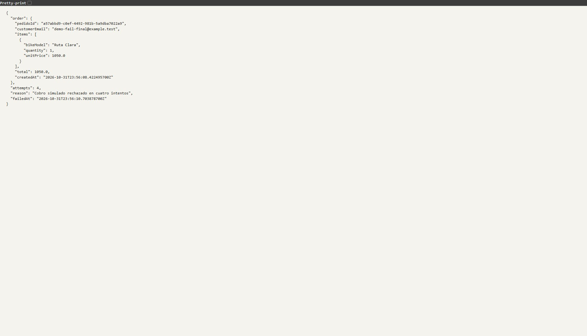

<em>Figura 11. Mensaje FailedPayment de una prueba aislada: mantiene el pedidoId, cuatro intentos y el motivo del fallo.</em>

### Trazabilidad y ejecución por procesos

  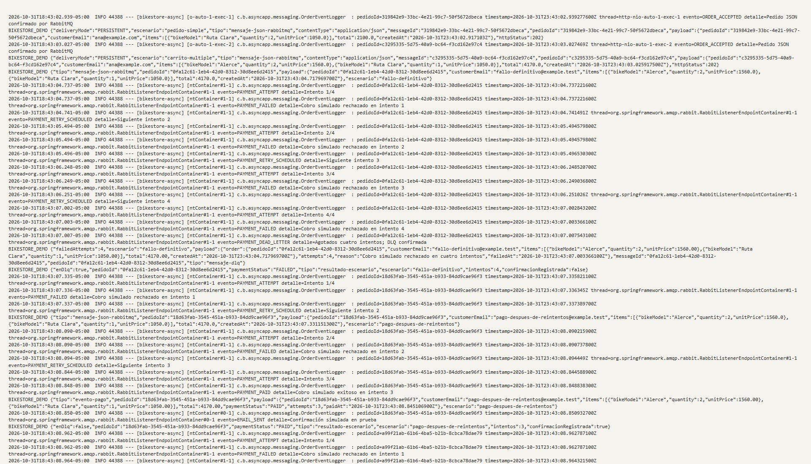

<em>Figura 12. Eventos observados con pedidoId, timestamp, thread, evento y detalle.</em>

  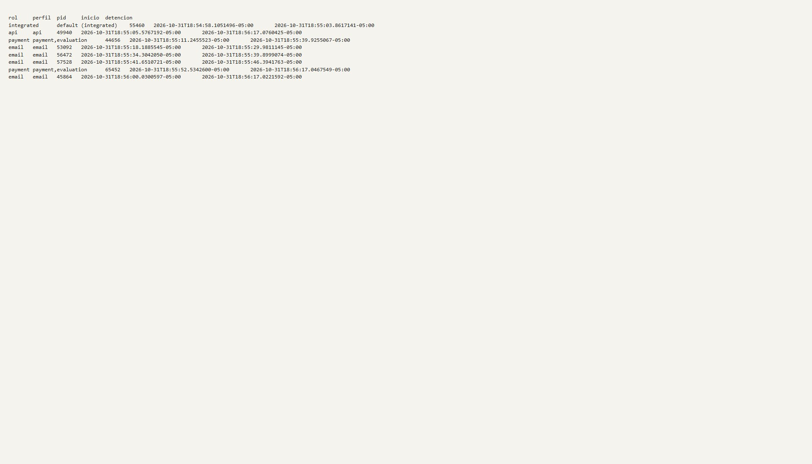

<em>Figura 13. Evidencia de ejecución de API, payment y email como procesos con PID independientes.</em>

La captura de aceptación del 1 de noviembre de 2026 se obtuvo con API, PaymentWorker y EmailWorker separados y conectados al vhost de evaluación. El mismo pedidoId aparece en la aceptación, el pago y la confirmación simulada. Al terminar, las cuatro colas de ese vhost tenían cero mensajes y cero consumidores; la instancia previa en el puerto 8080 y el vhost principal permanecieron intactos. El detalle está en [docs/PRUEBAS.md](docs/PRUEBAS.md).

## 14. Pruebas ejecutadas

La documentación separa pruebas unitarias, pruebas con RabbitMQ y comprobaciones de navegador. El workflow de [CI](.github/workflows/ci.yml) configura Java 17 y Node, ejecuta las pruebas unitarias y JavaScript, valida sintaxis y empaqueta con Maven. No ejecuta los escenarios RabbitMQ que dependen del broker local; estos se lanzan por separado con un runner que comprueba el vhost aislado. Los resultados detallados, comandos, límites y fragmentos de logs se mantienen en [docs/PRUEBAS.md](docs/PRUEBAS.md).

| Comprobación | Resultado documentado | Evidencia |
| --- | --- | --- |
| 21 pruebas unitarias Java sin RabbitMQ | Aprobadas en Maven y en CI | [CI](https://github.com/Juliomm8/bikestore-async/actions/workflows/ci.yml), [detalle](docs/PRUEBAS.md) |
| Pruebas JavaScript y sintaxis | Pruebas de carrito/persistencia y preparación de Pages aprobadas; archivos importantes pasan node --check | [detalle de comandos](docs/PRUEBAS.md) |
| Empaquetado Maven | Generación del JAR ejecutable comprobada | [resultados](docs/PRUEBAS.md) |
| Integración con RabbitMQ real | 9 casos deterministas en el vhost aislado: API, JSON persistente, reintentos, pago, DLQ y ausencia de correo al fallar | [resultados y artefactos](docs/DEMOSTRACION.md) |
| Separación de procesos | API, payment y email iniciados y detenidos de forma independiente; workers sin servidor web | [evidencia](docs/DEMOSTRACION.md) |
| GitHub Pages | URL pública respondió y se revisó en Chromium; no llamó a la API ni mostró errores de consola | [verificación y límites](docs/PRUEBAS.md) |

Los scripts que usan integración verifican primero el vhost de evaluación y abortan si detectan mensajes o consumidores preexistentes. No se deben ejecutar mientras haya trabajo en ese vhost. No vacían colas del vhost principal.

Comandos locales para las comprobaciones no destructivas descritas por la documentación:

~~~powershell
.\mvnw.cmd -q "-Dtest=ProcessProfileValidatorTest,OrderProducerTest,PaymentWorkerTest,EmailWorkerTest,OrderEventLoggerTest,OrderSubmissionServiceTest,OrderControllerMvcTest,OrderControllerTest,AssetCacheFilterTest" test
node --check src/main/resources/static/js/store.js
node --check scripts/prepare-github-pages.mjs
node --test src/test/javascript/cart-storage.test.cjs
node --test scripts/prepare-github-pages.test.mjs
.\mvnw.cmd -DskipTests package
~~~

Para los escenarios reales de RabbitMQ y los procesos separados, consulta [docs/DEMOSTRACION.md](docs/DEMOSTRACION.md) y [docs/PRUEBAS.md](docs/PRUEBAS.md) antes de ejecutar los scripts, especialmente sus condiciones de aislamiento y estado inicial.

## 15. Estructura del repositorio

~~~text
.github/workflows/          CI y publicación de GitHub Pages
docs/                       arquitectura, pruebas, imágenes y evidencia
docs/capturas/               capturas visuales incluidas en este README
scripts/                    runners de pruebas aisladas y preparación de Pages
src/main/java/.../api/       endpoint y coordinación del pedido
src/main/java/.../catalog/  catálogo y precios oficiales del servidor
src/main/java/.../config/   topología RabbitMQ y validación de perfiles
src/main/java/.../email/    consumidor y confirmación de correo simulada
src/main/java/.../messaging/ productor, confirmaciones y trazabilidad
src/main/java/.../payment/  consumidor, decisiones y reintentos de pago
src/main/resources/static/  frontend servido por Spring Boot y Pages
src/test/java/              pruebas unitarias y de integración Java
src/test/javascript/        pruebas del carrito y persistencia
pom.xml                     configuración Maven y Java 17
docker-compose.yml          RabbitMQ para el entorno local de BikeStore
~~~

## 16. Conclusiones y límites

El proyecto implementa el flujo pedido → publicación JSON → pago asíncrono → evento PAID o DLQ. Los consumidores pueden ejecutarse dentro del modo integrado o como procesos Java separados y se comunican por colas RabbitMQ. Las pruebas deterministas cubren éxito, reintentos, fallo definitivo y la condición de correo.

La solución se mantiene dentro del alcance académico: no almacena pedidos en una base de datos, no realiza cargos ni envía correo real, y los precios del catálogo son demostrativos aunque se calculan en el backend para cada pedido. GitHub Pages permite una revisión visual, pero la ejecución completa requiere Java, Docker y RabbitMQ localmente.
