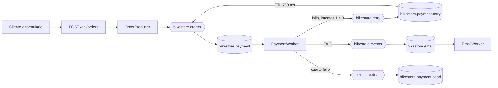

# BikeStore Async v1.0

Aplicación académica de pedidos de bicicletas con Java 17, Spring Boot 4.1.2 y RabbitMQ 4. El API acepta pedidos y responde de inmediato con un `pedidoId`; el pago y la confirmación de correo se simulan de forma asíncrona. No hay base de datos, cobros ni correos reales.

## Requisitos y arranque en Windows

- Java 17, Docker Desktop, PowerShell y Git.
- Puertos locales libres: 8080 para Spring Boot, 5672 para AMQP y 15672 para la administración de RabbitMQ.

```powershell
git clone https://github.com/Juliomm8/bikestore-async.git
Set-Location bikestore-async
Copy-Item .env.example .env
```

Edita `.env` y reemplaza la contraseña de ejemplo por una clave local. El archivo `.env` está ignorado por Git. Inicia exclusivamente el servicio RabbitMQ de este proyecto:

```powershell
docker compose up -d rabbitmq
docker compose ps
```

Carga las variables en la sesión de PowerShell que ejecutará Java, sin imprimir sus valores:

```powershell
Get-Content .env | ForEach-Object {
    if ($_ -match '^([^#=]+)=(.*)$') {
        [Environment]::SetEnvironmentVariable($matches[1], $matches[2], 'Process')
    }
}
.\mvnw.cmd spring-boot:run
```

Abre [http://localhost:8080/](http://localhost:8080/) para usar el formulario. El panel de RabbitMQ está en [http://localhost:15672/](http://localhost:15672/); utiliza las credenciales locales de `.env`.

## Catálogo y formulario

La página principal muestra seis bicicletas ficticias de montaña, ruta y uso urbano. Puedes filtrar las categorías, elegir un modelo y ajustar la cantidad; el total se actualiza en pantalla antes de enviar `customerEmail`, `bikeModel`, `quantity` y `unitPrice` a `POST /api/orders`. Tras recibir el `pedidoId`, la página aclara que el pago continúa de forma asíncrona. Las fotografías se sirven desde el proyecto y su procedencia está en [docs/IMAGENES.md](docs/IMAGENES.md).

Este catálogo es una demostración académica. Sus precios provienen del JavaScript del navegador y el backend no los valida contra un catálogo comercial de confianza.

## API

`POST /api/orders` recibe JSON. Un pedido válido responde `202 Accepted`:

```json
{
  "customerEmail": "ana@example.com",
  "bikeModel": "Montaña X",
  "quantity": 2,
  "unitPrice": 450.50
}
```

```json
{
  "pedidoId": "46513cc1-0b3a-4cbb-a18d-a9f64a5ca7e5",
  "status": "ACCEPTED"
}
```

`customerEmail` debe ser un correo válido, `bikeModel` no puede estar vacío, `quantity` debe ser al menos 1 y `unitPrice` debe ser mayor o igual a 0.01. Los datos inválidos reciben HTTP `400`. `ACCEPTED` significa que RabbitMQ confirmó la publicación, no que el pago haya terminado.

Ejemplo desde PowerShell:

```powershell
$body = @{
    customerEmail = 'ana@example.com'
    bikeModel = 'Montaña X'
    quantity = 2
    unitPrice = 450.50
} | ConvertTo-Json
Invoke-RestMethod -Uri 'http://localhost:8080/api/orders' -Method Post -ContentType 'application/json' -Body $body
```

## Arquitectura



Las colas son duraderas y los mensajes JSON son persistentes. El productor y el trabajador de pagos esperan confirmación de RabbitMQ antes de aceptar o reconocer el mensaje anterior. `PaymentWorker` utiliza una decisión aleatoria de 50 % de éxito por intento en la aplicación normal. Una cabecera `failedAttempts` limita el flujo a un intento inicial y tres reintentos adicionales. La cola de reintento espera 750 ms y usa un dead-letter exchange para devolver el mensaje a pagos. Al cuarto fallo se publica en la DLQ un JSON `FailedPayment` con el pedido completo, cuatro intentos, motivo y fecha. La cola de pagos también tiene un dead-letter exchange para mensajes inválidos rechazados.

`EmailWorker` consume una cola diferente, alimentada por el evento `payment.paid`. Comprueba `paymentStatus=PAID` antes de simular el correo. Dos trabajadores en la misma cola competirían por los mensajes, por lo que el correo depende del evento posterior al pago. Las excepciones de publicación pueden producir una nueva entrega; al no existir almacenamiento de idempotencia en esta versión académica, un fallo de confirmación excepcional podría repetir una simulación.

| Exchange | Routing key | Cola | Uso |
| --- | --- | --- | --- |
| `bikestore.orders` | `payment.requested` | `bikestore.payment` | Pedidos pendientes de pago |
| `bikestore.retry` | `payment.retry` | `bikestore.payment.retry` | Espera de 750 ms antes de otro intento |
| `bikestore.events` | `payment.paid` | `bikestore.email` | Confirmaciones después del pago |
| `bikestore.dead` | `payment.failed` | `bikestore.payment.dead` | Fallos definitivos y mensajes rechazados |

Los registros de negocio usan siempre `pedidoId`, `timestamp` UTC, `thread`, `evento` y `detalle`. El `pedidoId` permite seguir un pedido entre el API y ambos consumidores.

## Pruebas

Con RabbitMQ iniciado y las variables de `.env` cargadas en la sesión:

```powershell
.\mvnw.cmd test
.\mvnw.cmd package
docker exec bikestore-rabbitmq rabbitmqctl list_queues name messages arguments
```

Las pruebas de integración usan el RabbitMQ real y reemplazan la decisión aleatoria por resultados deterministas. También crean temporalmente una cola de auditoría para comprobar los eventos `PAID` sin competir con `EmailWorker`; la eliminan al terminar. Consulta [docs/PRUEBAS.md](docs/PRUEBAS.md) para los escenarios y resultados ejecutados.

Las pruebas vacían las colas de BikeStore antes de cada escenario; ejecútalas con la aplicación detenida y sin pedidos pendientes.

Si existe una cola `bikestore.payment` creada con una versión anterior sin dead-letter exchange, RabbitMQ rechazará cambiar sus argumentos en caliente. Antes de migrarla, inspecciona sus mensajes y procesa o conserva cualquier pedido pendiente; solo cuando esté vacía se puede eliminar esa cola específica para que la aplicación la declare de nuevo.
