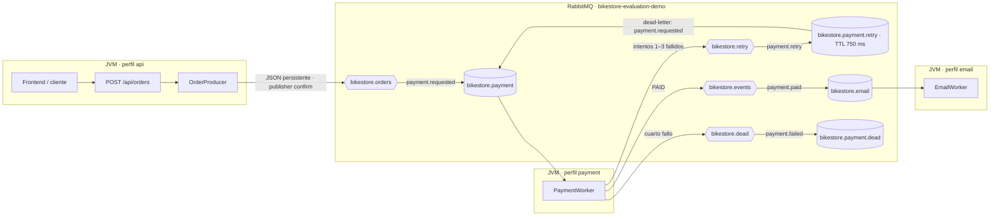

# Verificación de procesos independientes

Ejecución observada: **31 de octubre de 2026**, en Windows 11, Java 17, Spring Boot 4.1.2 y el contenedor RabbitMQ de BikeStore. API, PaymentWorker y EmailWorker usaron el mismo JAR y RabbitMQ real, en el vhost aislado `bikestore-evaluation-demo`.

## Arquitectura



Un solo proyecto Maven genera un JAR. `spring.profiles.default=integrated` conserva el arranque de desarrollo con API y los dos workers juntos. Los perfiles `api`, `payment` y `email` seleccionan un rol cada uno. Payment y email activan `spring.main.web-application-type=none`; el validador rechaza perfiles de rol incompatibles. La decisión aleatoria de producción permanece en 50 % por intento. El perfil de apoyo `evaluation`, disponible únicamente junto con `payment`, usa éxito determinista salvo para correos `demo-fail-*`; el script lo dirige exclusivamente al vhost aislado.

## Ejecución reproducible

Desde PowerShell, en la raíz del repositorio:

```powershell
docker compose ps
.\mvnw.cmd -DskipTests package
.\scripts\Test-ProcesosIndependientes.ps1
```

El runner confirma la salud del contenedor RabbitMQ de BikeStore y la identidad del vhost antes de operar. Aborta si encuentra mensajes, mensajes sin reconocer o consumidores existentes en ese vhost. Usa `18080` y `18081` para sus APIs de prueba, lee credenciales localmente desde `.env`, no las escribe en evidencias y detiene solo los PID que inició. Al final conserva el JSON de la DLQ y las colas observadas; purga únicamente el mensaje creado por la prueba tras comprobar el vhost, los consumidores y los conteos esperados.

Para operar el sistema de forma distribuida, compila una vez y abre tres terminales en la raíz:

```powershell
java -jar target\bikestore-async-0.0.1-SNAPSHOT.jar --spring.profiles.active=api
java -jar target\bikestore-async-0.0.1-SNAPSHOT.jar --spring.profiles.active=payment
java -jar target\bikestore-async-0.0.1-SNAPSHOT.jar --spring.profiles.active=email
```

Detén un proceso con `Ctrl+C` en su terminal. RabbitMQ Management está en `http://127.0.0.1:15672`; en **Connections** se ven las conexiones activas y en **Queues** un consumidor para `bikestore.payment` y otro para `bikestore.email`. El perfil `api` abre su conexión al publicar el primer pedido; los workers la abren durante el arranque. La autenticación utiliza `.env` local.

El arranque compatible de desarrollo es `.\mvnw.cmd spring-boot:run`, sin perfil explícito. Lo comprobé con `SERVER_PORT=18082` y el vhost de evaluación para no interferir con la instancia que ya ocupaba `8080`.

## Resultados observados

La corrida final del runner capturó el estado de los procesos y los mensajes en [escenarios.log](evidencia/procesos/20261031-185451/escenarios.log), [procesos.tsv](evidencia/procesos/20261031-185451/procesos.tsv), [eventos-workers.log](evidencia/procesos/20261031-185451/eventos-workers.log), [perfiles-y-servidor-web.log](evidencia/procesos/20261031-185451/perfiles-y-servidor-web.log), [mensaje-dlq.json](evidencia/procesos/20261031-185451/mensaje-dlq.json) y las [colas antes de limpiar](evidencia/procesos/20261031-185451/colas-antes-de-limpieza.txt) y [después de limpiar](evidencia/procesos/20261031-185451/colas-finales.txt).

| Comprobación | Resultado real |
| --- | --- |
| Modo integrado predeterminado | PID `55460`, HTTP 200 en `18081`, un consumidor en cada cola. |
| Perfil `api` aislado | PID `49940`, HTTP 200 en `18080`, cero consumidores en las dos colas. |
| Perfil `payment` | PID `44656`, consumidor `bikestore.payment=1`, `bikestore.email=0`, cero puertos de escucha. |
| Perfil `email` aislado | PID `57528`, consumidor `bikestore.email=1`, `bikestore.payment=0`, cero puertos de escucha. |
| Escenario A, flujo completo | API PID `49940`, pago PID `44656`, correo PID `53092`; tres PID distintos. `pedidoId=cfe606e0-7a0e-49e6-a586-04399aa44447` llegó a `PAYMENT_PAID` y `EMAIL_SENT`. |
| Escenario B, EmailWorker detenido | `pedidoId=2d14e9e7-f7e5-4a9f-9553-9d2f337566bd` quedó en `bikestore.email` con `messages_ready=1`; tras reiniciar email (PID `56472`) se registró `EMAIL_SENT` con ese mismo ID. API y payment siguieron activos. |
| Escenario C, PaymentWorker detenido | API respondió `202` para `pedidoId=083cfb8b-9dbb-46f2-bcbd-302c50365949`; el pedido esperó en `bikestore.payment`. Al reiniciar payment (PID `65452`) llegó a `PAID`; al arrancar email (PID `45864`) se registró la confirmación. |
| Escenario D, cuatro fallos | `pedidoId=a57abbd9-c0ef-4492-981b-5a9dba7022a9` produjo cuatro eventos `PAYMENT_ATTEMPT`, terminó en `bikestore.payment.dead` con `attempts=4` y no apareció en la cola de correo ni en sus eventos. El JSON recibido desde Management está en `mensaje-dlq.json`. |

El archivo `perfiles-y-servidor-web.log` registra los perfiles efectivos. El runner también comprueba que las JVM worker no tengan sockets en estado `Listen`; durante la prueba el puerto preexistente `8080` conservó el mismo PID y no se utilizó para levantar otra API. La API de rol usa conexión RabbitMQ diferida: antes de publicar no aparece en **Connections**, y al emitir el primer pedido se observa junto con las conexiones de ambos workers.

### Comprobación de `spring-boot:run`

En una corrida independiente, el comando `.\mvnw.cmd spring-boot:run` informó que, sin perfil activo, cargaba `integrated`; levantó Tomcat en `18082`, respondió HTTP 200 en `/` y RabbitMQ mostró un consumidor por cola en `bikestore-evaluation-demo`. Tras `Ctrl+C`, el puerto de prueba quedó libre y ambos conteos de consumidores volvieron a cero. La observación resumida está en [spring-boot-run-smoke.txt](evidencia/procesos/20261031-184637/spring-boot-run-smoke.txt); se aplicaron esos overrides temporales para mantener intacta la instancia de `8080`.

Las pruebas deterministas de API/pagos con RabbitMQ real ejecutaron 4 casos de `OrderApiIntegrationTest` y 5 de `PaymentIntegrationTest`, sin fallos. Sus mensajes JSON, eventos, topología y colas están en [la evidencia de integración](evidencia/demostracion/20261031-184253). El detalle acumulado de comandos se mantiene en [docs/PRUEBAS.md](PRUEBAS.md).

La evidencia incluye registros de texto y salidas de RabbitMQ; no incluye capturas del panel gráfico de Management. No se realizó un cobro ni se envió correo real. Los registros de consola se filtraron para conservar perfiles, PID y eventos de negocio sin rutas locales ni contraseñas.
