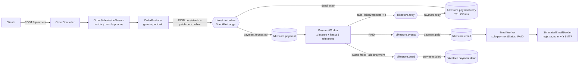

# Demostración académica: BikeStore Async

Fecha de ejecución observada: **31 de octubre de 2026**. Esta guía describe el código de `main` y una ejecución determinista contra el RabbitMQ real de BikeStore. No se hicieron cobros ni envíos de correo reales.

## Ejecución segura y reproducible

El API, `PaymentWorker` y `EmailWorker` se configuran hoy en la misma aplicación Spring Boot. Para que las pruebas de integración no publiquen, consuman ni purguen pedidos de la instancia habitual, ambas clases de integración fijan `spring.rabbitmq.virtual-host=bikestore-evaluation-demo` y comprueban ese valor antes de operar. `PaymentIntegrationTest` purga únicamente las colas dentro de ese vhost aislado; la prueba del API exige que su cola de pagos esté vacía antes de publicar.

Desde PowerShell, en la raíz del repositorio:

```powershell
docker compose ps
.\scripts\Run-RabbitMqDemostracion.ps1
```

El runner verifica que el servicio `rabbitmq` del Compose de BikeStore esté saludable. Si el vhost no existe, lo crea y concede permisos al usuario local definido en `.env`; lee las credenciales sin imprimirlas. Antes de ejecutar Maven, aborta si encuentra mensajes listos, mensajes sin reconocer o consumidores en las colas del vhost de demostración. No inicia, detiene ni modifica contenedores de otros proyectos.

El runner ejecuta:

```powershell
.\mvnw.cmd "-Dtest=OrderApiIntegrationTest,PaymentIntegrationTest" test
```

Cada ejecución genera una carpeta nueva bajo `docs/evidencia/demostracion/` con la captura de mensajes y eventos, el estado de las colas, los exchanges y los bindings. Si el runner detecta una cola ocupada o un consumidor activo en ese vhost, cancela sin purgarla.

La ejecución documentada quedó en [mensajes y eventos](evidencia/demostracion/20261031-174818/mensajes-y-eventos.log), [colas finales](evidencia/demostracion/20261031-174818/colas-finales.txt), [exchanges](evidencia/demostracion/20261031-174818/exchanges.txt) y [bindings](evidencia/demostracion/20261031-174818/bindings.txt). Son capturas textuales del reporte de integración y de `rabbitmqctl`, no una captura de pantalla del panel de administración.

El primer intento reveló una aserción de prueba que comparaba el contador de RabbitMQ (`Long`) con un entero (`0` frente a `0L`). Se corrigió la comparación, se repitió la demostración y el resultado final fue **9 pruebas aprobadas, 0 fallos y 0 errores**: 4 de `OrderApiIntegrationTest` y 5 de `PaymentIntegrationTest`.

## Flujo y arquitectura observados



`OrderProducer` crea un UUID y publica una sola representación JSON del pedido completo. `ConfirmedPublisher` serializa como `application/json`, marca el mensaje `PERSISTENT`, establece `messageId=pedidoId`, utiliza publicación obligatoria y espera la confirmación del broker. El API responde `202 Accepted` cuando la publicación queda confirmada.

`PaymentWorker` recibe de una cola distinta a la de correo. La decisión de producción usa `ThreadLocalRandom.current().nextBoolean()`, que da probabilidad 50/50 en cada intento. La prueba reemplaza esa decisión por `ScriptedDecision`, de modo que los cuatro escenarios no dependen del azar. La cabecera `failedAttempts` permite contar el intento inicial y los tres reintentos adicionales; `bikestore.payment.retry` espera 750 ms y vuelve a enrutar el mensaje a la cola de pagos.

## Mensajes y resultados capturados

`OrderApiIntegrationTest` publicó pedidos reales por HTTP y leyó sus mensajes desde el vhost de demostración con los consumidores de esa prueba desactivados. La captura registró HTTP `202`, `contentType=application/json`, `deliveryMode=PERSISTENT` y el mismo `pedidoId` en el `messageId` y en el cuerpo. Por ejemplo, el carrito múltiple de esa ejecución fue:

```json
{
  "pedidoId": "8a1399b3-dca3-4365-acda-7084d6cf90ac",
  "customerEmail": "ana@example.com",
  "items": [
    { "bikeModel": "Alerce", "quantity": 2, "unitPrice": 1560.0 },
    { "bikeModel": "Ruta Clara", "quantity": 1, "unitPrice": 1050.0 }
  ],
  "total": 4170.0,
  "createdAt": "2026-10-31T22:48:28.888332800Z"
}
```

La integración de pagos publica fixtures directamente a RabbitMQ para controlar cada decisión y usa los mismos modelos y precios del catálogo. Las direcciones `@example.test` identifican el escenario determinista; no son destinatarios reales.

| Escenario observado | `pedidoId` | Resultado verificado |
| --- | --- | --- |
| Pago inmediato | `0a9b31e7-a69b-4f9d-b225-54badb7b3d1c` | `PAID`, intento 1, confirmación registrada por el sender de prueba, sin DLQ. |
| Dos fallos y pago posterior | `ded2999a-66a0-48b9-b8e3-2d8edd8a8d7d` | `PAID`, intento 3, confirmación registrada por el sender de prueba, sin DLQ. |
| Pago al último intento | `6cdeaf60-fd12-4df6-86d2-8956c0bb0e55` | `PAID` en el intento 4, tras tres reintentos, sin DLQ. |
| Fallo definitivo | `e3192be3-fa33-43bb-adb1-e7306acadd86` | Cuatro intentos; `FailedPayment` recibido desde `bikestore.payment.dead`; `failedAttempts=4`; ninguna confirmación de correo registrada. |

El cuerpo capturado desde la DLQ conservó el pedido y el motivo:

```json
{
  "order": {
    "pedidoId": "e3192be3-fa33-43bb-adb1-e7306acadd86",
    "customerEmail": "fallo-definitivo@example.test",
    "items": [
      { "bikeModel": "Alerce", "quantity": 2, "unitPrice": 1560.00 },
      { "bikeModel": "Ruta Clara", "quantity": 1, "unitPrice": 1050.00 }
    ],
    "total": 4170.00,
    "createdAt": "2026-10-31T22:48:30.519416600Z"
  },
  "attempts": 4,
  "reason": "Cobro simulado rechazado en cuatro intentos",
  "failedAt": "2026-10-31T22:48:32.810384Z"
}
```

RabbitMQ entregó ese mensaje a la prueba, que verificó `messageId` y la cabecera `failedAttempts=4` antes de conservar el JSON en la captura. La prueba consumió el mensaje después de inspeccionarlo; por eso, las colas del vhost de demostración terminaron vacías. El escenario también comprobó que no apareció un evento de pago exitoso ni se invocó el sender de correo.

Una línea de log real para el cuarto fallo incluye los tres campos de trazabilidad:

```text
2026-10-31T17:48:32.813-05:00 INFO ... pedidoId=e3192be3-fa33-43bb-adb1-e7306acadd86 timestamp=2026-10-31T22:48:32.813506800Z thread=org.springframework.amqp.rabbit.RabbitListenerEndpointContainer#1-1 evento=PAYMENT_DEAD_LETTER detalle=Agotados cuatro intentos; DLQ confirmada
```

Las colas `bikestore.payment`, `bikestore.payment.retry`, `bikestore.email` y `bikestore.payment.dead` quedaron con `messages_ready=0`, `messages_unacknowledged=0` y `consumers=0` en el vhost de demostración. En el vhost principal `/`, antes y después se conservó el mensaje que ya existía en la DLQ (`1`) y siguieron conectados los consumidores de la instancia que ya estaba activa en 8080 (`bikestore.payment` y `bikestore.email`). No se purgó ni se reconoció ese pedido.

## ACK y tratamiento de mensajes

`application.properties` selecciona reconocimiento manual. Cuando el pago falla antes del cuarto intento, `PaymentWorker` publica el mensaje en el exchange de reintento y, después de la confirmación de publicación, hace `basicAck` del mensaje que ya procesó. Tras el cuarto fallo publica `FailedPayment` en el exchange de dead letter y reconoce el original. Si el pago queda `PAID`, publica el resultado en `bikestore.events` y reconoce el pedido. `EmailWorker` reconoce después de procesar un resultado `PAID`; para otro estado lo registra como omitido y no invoca el sender. Los tests unitarios verifican estas llamadas a `basicAck`; las pruebas con RabbitMQ confirman que los mensajes recorren las colas y salen de ellas.

## Situación de los workers y correo

`BikestoreAsyncApplication` inicia un solo contexto Spring Boot que escanea `PaymentWorker` y `EmailWorker` como componentes. Sus `@RabbitListener` usan contenedores e hilos separados, pero ambos workers viven en el mismo proceso JVM que el API; **no son procesos independientes en la configuración actual**. No se cambió ese diseño en esta entrega.

La modificación mínima para ejecutar roles separados sería permitir habilitar cada componente con una propiedad —por ejemplo, `bikestore.workers.payment.enabled` y `bikestore.workers.email.enabled` mediante `@ConditionalOnProperty`— y lanzar el mismo JAR con flags distintos. Las instancias worker podrían usar `spring.main.web-application-type=none`; el proceso de API mantendría los dos workers deshabilitados. Los exchanges y colas podrían seguir declarados por la configuración compartida. Esta propuesta requiere una prueba de arranque para cada rol antes de adoptarla.

El envío actual es simulado: `SimulatedEmailSender` escribe `EMAIL_SENT` y un resumen del pedido en el log. Las pruebas de integración sustituyen ese bean por `RecordingEmailSender`, que guarda identificadores de pedidos confirmados, no abre SMTP y no envía correos. Si la exposición necesita mostrar un mensaje recibido, la opción acotada sería un perfil de demostración con un adaptador `JavaMailSender` dirigido a un servidor SMTP de pruebas local como Mailpit. No se requiere una cuenta externa ni cambiar el sender de producción; esta alternativa no se instaló ni se probó aquí.

## Revisión por requisito

| Requisito | Implementación actual | Prueba o revisión | Evidencia disponible |
| --- | --- | --- | --- |
| `OrderProducer` publica JSON | UUID, cuerpo JSON, `messageId`, persistencia y confirmación del publisher. | `OrderApiIntegrationTest`, `OrderProducerTest`. | Dos publicaciones HTTP reales capturadas; `202`, `application/json`, `PERSISTENT`. |
| Fallo aleatorio de 50 % | `RandomPaymentDecision` usa `nextBoolean()` en cada intento. | Revisión del código; las pruebas sustituyen esta decisión por una secuencia determinista. | Código de producción; la ejecución cubre cada camino, no una medición estadística de la aleatoriedad. |
| Tres reintentos adicionales | `MAX_ATTEMPTS=4`, cabecera `failedAttempts` y cola TTL de 750 ms. | `PaymentIntegrationTest`, `PaymentWorkerTest`. | Pago en intento 3 e intento 4; logs de intentos y reintentos. |
| DLQ tras cuatro fallos | `FailedPayment` conserva pedido, motivo, fecha y contador. | `fourFailuresReachDeadLetterQueue`, `fourthFailurePublishesTheWholeOrderToDeadLetterQueue`. | Mensaje real leído de la DLQ, `pedidoId` y `failedAttempts=4` en el log guardado. |
| Correo solo para `PAID` | `EmailWorker` valida el estado y consume una cola del evento pagado. | `PaymentIntegrationTest`, `EmailWorkerTest`. | Sender de prueba invocado para `PAID`; no invocado para fallo ni `PENDING`. |
| Logs trazables | `OrderEventLogger` incluye `pedidoId`, `timestamp`, `thread`, evento y detalle. | `OrderEventLoggerTest` y logs de consumidores reales. | Captura de eventos desde API, PaymentWorker y EmailWorker. |
| ACK manual | Publica el resultado/reintento/DLQ antes de reconocer el mensaje original. | `PaymentWorkerTest`, `EmailWorkerTest` verifican `basicAck`; integración inspecciona colas drenadas. | Código y captura de eventos; no se midió el frame AMQP ACK en una traza de protocolo. |
| Procesos separados | Hoy API y dos listeners comparten el proceso Spring Boot. | Revisión de `@SpringBootApplication`, `@Component` y `@RabbitListener`. | Situación actual y propuesta mínima descritas arriba; no se modificó ni se probó separación por proceso. |
| Envío de correo | `SimulatedEmailSender` solo registra en consola. | `EmailWorkerTest` y sender registrador en integración. | No se envió ningún correo real; Mailpit/SMTP queda como demostración opcional propuesta. |

## Guion de exposición de cinco minutos

**0:00–0:40 — Problema y objetivo.** “El endpoint no espera a que se complete el pago. Acepta el pedido, confirma la publicación y devuelve un `pedidoId`; desde ahí el procesamiento continúa por mensajes.”

**0:40–1:25 — Productor y contrato.** “`OrderController` valida la solicitud y `OrderSubmissionService` calcula el precio con el catálogo del servidor. `OrderProducer` genera un UUID y serializa el carrito completo. `ConfirmedPublisher` marca el JSON como persistente y espera el publisher confirm de RabbitMQ antes de responder `202`.”

**1:25–2:05 — Exchanges y colas.** “El exchange directo `bikestore.orders` usa `payment.requested` para entregar a `bikestore.payment`. La topología también tiene `bikestore.retry`, `bikestore.events` y `bikestore.dead`; las colas persistentes separan trabajo, reintentos, correo y fallos definitivos.”

**2:05–3:00 — Pago y reintentos.** “En ejecución normal `RandomPaymentDecision` decide con un booleano aleatorio, 50 % para cada resultado. La prueba reemplaza esa pieza por una secuencia reproducible: éxito en el primero, éxito en el tercero y fallo en los cuatro intentos. La cola de retry espera 750 ms y enruta de vuelta el mismo pedido.”

**3:00–3:45 — ACK y DLQ.** “El listener usa ACK manual. Primero publica y espera confirmación del siguiente mensaje; luego reconoce el original. Después del cuarto fallo publica `FailedPayment` en `bikestore.payment.dead`, con el mismo `pedidoId`, contador 4, motivo y fecha. Así no se crea un ciclo infinito.”

**3:45–4:25 — Correo y trazabilidad.** “El correo no compite con PaymentWorker por la cola de pedidos. El pago publica `PAID` en el exchange de eventos y una cola propia alimenta EmailWorker. Solo `PAID` llama al sender. En esta versión ese sender es una simulación; los logs llevan pedido, timestamp e hilo.”

**4:25–5:00 — Evidencia y límites.** “La demostración corre contra un vhost dedicado y determinista; las capturas muestran JSON, reintentos, DLQ y colas finales vacías. No toca los pedidos del vhost principal. Los workers todavía comparten proceso con el API y el correo no usa SMTP real; esas son mejoras posibles, no capacidades que afirmemos como implementadas.”
