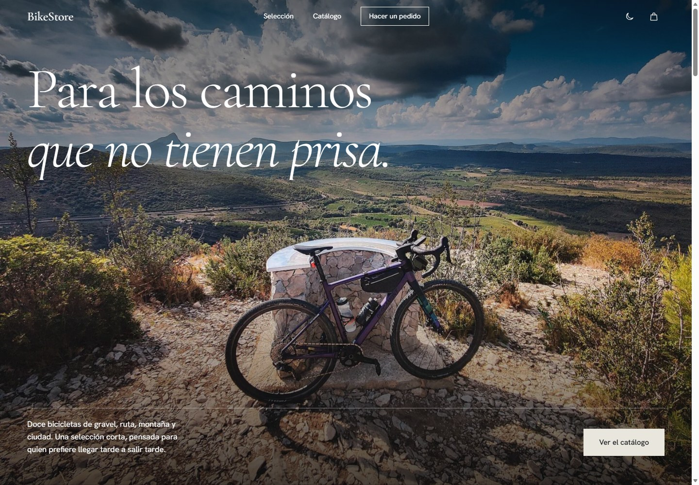
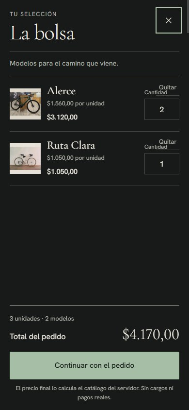

# Pruebas y evidencia de BikeStore Async v1.0

Fecha de ejecución: 29 de octubre de 2026, zona horaria `America/Guayaquil`. Se utilizó Java 17, Spring Boot 4.1.2 y el contenedor existente `bikestore-rabbitmq` con RabbitMQ 4. Las marcas `timestamp` de negocio están en UTC.

## Comandos ejecutados

Con las variables `RABBITMQ_USER` y `RABBITMQ_PASSWORD` cargadas desde el `.env` local en PowerShell, sin imprimir sus valores:

```powershell
.\mvnw.cmd test -q
.\mvnw.cmd package -q
docker compose ps
docker exec bikestore-rabbitmq rabbitmqctl list_queues name messages arguments
java -jar target/bikestore-async-0.0.1-SNAPSHOT.jar
```

El paquete y la aplicación iniciaron correctamente. Spring Boot escuchó en el puerto 8080 y se conectó a RabbitMQ en el 5672. `GET /` devolvió `200` y un `POST /api/orders` manual devolvió `202` con `pedidoId=46513cc1-0b3a-4cbb-a18d-a9f64a5ca7e5`. Esa ejecución observó `ORDER_ACCEPTED`, `PAYMENT_ATTEMPT`, `PAYMENT_PAID` y `EMAIL_SENT` para el mismo identificador. La aplicación manual se cerró después de la comprobación.

## Pruebas automatizadas ejecutadas

El último `mvnw.cmd package -q` ejecutó **10 pruebas: 10 correctas, 0 fallos, 0 errores, 0 omitidas**. `OrderApiIntegrationTest` desactiva los consumidores para inspeccionar el pedido original; `PaymentIntegrationTest` usa los consumidores, el RabbitMQ real y decisiones de pago deterministas.

Esta primera serie se ejecutó sin otra instancia de BikeStore y con las colas vacías. Sus preparaciones vacían las colas de este proyecto, por lo que no deben ejecutarse mientras haya pedidos reales pendientes. La serie posterior del frontend se aisló en otro vhost, como se detalla más abajo.

| Escenario | Prueba y resultado observado |
| --- | --- |
| Pedido válido y JSON persistente | `OrderApiIntegrationTest`: HTTP `202`; cuerpo y `pedidoId` coinciden con el mensaje de `bikestore.payment`; `contentType=application/json` y `receivedDeliveryMode=PERSISTENT`. |
| Pedido inválido | `OrderApiIntegrationTest`: HTTP `400` y ningún mensaje nuevo en la cola de pagos. |
| Formulario | `OrderApiIntegrationTest`: `GET /` devuelve `200` y el formulario usa `/api/orders`. |
| Pago exitoso inicial | `PaymentIntegrationTest`: evento `PAID` con `attempts=1`; el consumidor de correo registró la confirmación. |
| Reintentos y éxito posterior | `PaymentIntegrationTest`: fallos en los intentos 1 y 2; éxito `PAID` en el intento 3; exactamente tres llamadas a la decisión de pago. |
| Éxito en el último intento | `PaymentIntegrationTest`: `PAID` en el intento 4 tras tres reintentos, confirmación de correo y ausencia en la DLQ. |
| Fallo definitivo | `PaymentIntegrationTest`: cuatro fallos, JSON `FailedPayment` en `bikestore.payment.dead` con `pedidoId`, `attempts=4`, motivo y cabecera `failedAttempts=4`; sin evento `PAID` ni correo. |
| Correo solo para pagados | `PaymentIntegrationTest`: un evento sintético `PENDING` se consumió sin enviar confirmación. |
| Trazabilidad | `OrderEventLoggerTest`: el registro incluye `pedidoId`, `timestamp` ISO y `thread`. |
| Inicio de contexto | `BikestoreAsyncApplicationTests`: contexto Spring Boot iniciado. |

Se comprobó además la topología real de RabbitMQ: `bikestore.payment`, `bikestore.payment.retry`, `bikestore.email` y `bikestore.payment.dead` existían. La cola de reintento tenía `x-message-ttl=750` y retorno a `bikestore.orders`; la de pagos tenía dead-letter exchange `bikestore.dead`. Las cuatro colas estaban vacías después de las pruebas.

## Fragmentos de logs observados

Las siguientes líneas provienen de la ejecución automatizada. Se usa el mismo `pedidoId` para seguir dos fallos, el éxito y el correo; no contienen credenciales:

```text
pedidoId=4f95be6c-c76c-41d8-8521-dc56ac27dea9 timestamp=2026-10-29T09:00:51.427385300Z thread=org.springframework.amqp.rabbit.RabbitListenerEndpointContainer#1-1 evento=PAYMENT_FAILED detalle=Cobro simulado rechazado en intento 1
pedidoId=4f95be6c-c76c-41d8-8521-dc56ac27dea9 timestamp=2026-10-29T09:00:52.181084300Z thread=org.springframework.amqp.rabbit.RabbitListenerEndpointContainer#1-1 evento=PAYMENT_ATTEMPT detalle=Intento 2/4
pedidoId=4f95be6c-c76c-41d8-8521-dc56ac27dea9 timestamp=2026-10-29T09:00:52.938332200Z thread=org.springframework.amqp.rabbit.RabbitListenerEndpointContainer#1-1 evento=PAYMENT_PAID detalle=Cobro simulado exitoso en intento 3
pedidoId=4f95be6c-c76c-41d8-8521-dc56ac27dea9 timestamp=2026-10-29T09:00:52.942370200Z thread=org.springframework.amqp.rabbit.RabbitListenerEndpointContainer#0-1 evento=EMAIL_SENT detalle=Confirmación simulada en prueba
```

## Alcance de la comprobación

Las pruebas automatizadas inspeccionaron mensajes y colas reales con RabbitMQ. El éxito manual en 8080 dependió del resultado aleatorio y fue complementado con pruebas deterministas para todos los caminos de pago. No se ejecutaron cobros ni envíos de correo reales, de acuerdo con el alcance académico.

## Revisión del catálogo y formulario

El 29 de octubre de 2026 se ejecutó de nuevo `node --check src/main/resources/static/js/store.js` y `./mvnw.cmd package -q` desde PowerShell. El paquete terminó con **10 pruebas correctas, 0 fallos, 0 errores y 0 omitidas**. `OrderApiIntegrationTest` comprobó además que `GET /`, `/js/store.js`, `/css/store.css` y `/images/ruta-clara.jpg` se sirven con HTTP `200`.

Había otra instancia de BikeStore activa en el puerto 8080. Para evitar que sus consumidores interfirieran con las pruebas de RabbitMQ, se creó el vhost `bikestore_frontend_test` dentro del contenedor **propio** `bikestore-rabbitmq`, se dieron permisos al usuario local de BikeStore y se ejecutó Maven con `SPRING_RABBITMQ_VIRTUAL_HOST=bikestore_frontend_test`. No se detuvo ni modificó ningún contenedor ajeno. El comando de prueba fue:

```powershell
Get-Content .env | ForEach-Object {
  if ($_ -match '^([^#=]+)=(.*)$') {
    [Environment]::SetEnvironmentVariable($matches[1], $matches[2], 'Process')
  }
}
$env:SPRING_RABBITMQ_VIRTUAL_HOST = 'bikestore_frontend_test'
node --check src/main/resources/static/js/store.js
.\mvnw.cmd package -q
```

La revisión manual se hizo en Chromium contra `http://localhost:8080/`, con el backend real activo. Se inspeccionaron capturas de página completa a **1440 × 900** y **390 × 844**. También se midió el ancho del documento a **320** y **768 px**: no hubo desbordamiento horizontal. Las seis fotografías locales se cargaron y la consola no registró errores ni advertencias.

| Escenario del frontend | Resultado observado en navegador |
| --- | --- |
| Filtro Ruta | El catálogo mostró exactamente dos bicicletas y el filtro cambió a `aria-pressed=true`. |
| Selección y total | Al elegir `Ruta Clara`, el panel mostró modelo y precio unitario `$1.050,00`; con cantidad `2`, el total pasó a `$2.100,00`. |
| Correo inválido | `invalido` mostró `Ingresa un correo electrónico válido.` sin enviar un POST. |
| Cantidad inválida | `0` eliminó el total y mostró `Ingresa una cantidad entera de al menos 1.` |
| Estado de carga | Durante el POST, el botón quedó deshabilitado con el texto `Enviando pedido` y apareció `Registrando tu pedido…`. |
| Pedido válido | Se envió `{"customerEmail":"frontend.qa@example.com","bikeModel":"Ruta Clara","quantity":2,"unitPrice":1050}`. El API devolvió HTTP `202`, `status=ACCEPTED` y `pedidoId=1b6f1ee4-add1-47be-b556-788f067ccf40`; la interfaz mostró ese ID y explicó que el pago se procesa de forma asíncrona. |
| Accesibilidad básica | `Tab` enfocó el enlace de salto con contorno visible; los campos tenían etiquetas, las imágenes cargadas tenían texto alternativo y no hubo IDs duplicados. |

Las capturas y el registro de revisión se guardaron localmente en `target/ui-review/` (directorio ignorado por Git). El verificador de evidencias del flujo de diseño informó `Evidence record complete` tras revisar los dos tamaños, estados y artefactos. Esta comprobación visual fue manual; los mensajes y la respuesta HTTP sí se observaron en el navegador real.

## Rediseño visual (29 de octubre de 2026)

Se ejecutó `mvnw.cmd package -q` con las variables de `.env` cargadas, `RABBITMQ_HOST=127.0.0.1` y las colas vacías: **10 pruebas correctas, 0 fallos**. La prueba `orderFormIsServed` se actualizó a los nuevos nombres de clases CSS (`.card`, `.order__panel`).

Con la aplicación real y Google Chrome controlado por Playwright (escritorio 1440×900 y móvil 390×844):

| Comprobación | Resultado |
| --- | --- |
| Carga de portada | Sin errores de consola ni de red (se añadió un favicon para evitar un 404). |
| Filtro Gravel | Mostró 5 bicicletas. |
| Selección de `Alerce` y cantidad 2 | Total `$3.120,00`; la barra de selección llevó al pedido. |
| Envío | Cuerpo `{"customerEmail":"test@example.com","bikeModel":"Alerce","quantity":2,"unitPrice":1560}`; el API respondió 202 y la interfaz mostró el `pedidoId` aclarando que el pago aún no se ha procesado. |
| Menú móvil | Se abre, muestra los tres enlaces, cambia a «Cerrar» y se cierra con Esc o al elegir un enlace. |
| Desbordamiento horizontal | No hubo en 390 px en portada, selección, catálogo, pedido y pie. |

No se probó con lectores de pantalla ni en Firefox/Safari. Las animaciones respetan `prefers-reduced-motion` por CSS y JavaScript, pero esa preferencia no se activó en el navegador durante la revisión.

## Encuadres y revisión responsive (29 de octubre de 2026)

Se inspeccionaron individualmente los doce archivos de producto y las tres imágenes de la selección en Chromium, con Spring Boot ya activo en `http://localhost:8080/`. Las fotos locales de catálogo, destacados y pedido se comprobaron con el encuadre final. Las capturas completas se guardaron bajo `target/ui-review/capturas/`; ese directorio está ignorado por Git y no forma parte de la entrega versionada.

| Vista comprobada | Composición medida | Carga y desbordamiento |
| --- | --- | --- |
| 360 × 800 | Catálogo de una columna; cabecera y pedido en una columna; foto de cabecera con `contain`. | 12 fichas y 16 imágenes locales cargadas; sin desplazamiento horizontal. |
| 390 × 844 | Catálogo de una columna; cabecera y pedido en una columna; foto de cabecera con `contain`. | 12 fichas y 16 imágenes locales cargadas; sin desplazamiento horizontal. |
| 768 × 1024 | Catálogo de dos columnas; selección apilada; pedido de una columna. | 12 fichas y 16 imágenes locales cargadas; sin desplazamiento horizontal. |
| 1366 × 900 | Catálogo de tres columnas; pedido de dos columnas; cabecera panorámica. | 12 fichas y 16 imágenes locales cargadas; sin desplazamiento horizontal. |
| 1440 × 900 | Catálogo de tres columnas; pedido de dos columnas; cabecera panorámica. | 12 fichas y 16 imágenes locales cargadas; sin desplazamiento horizontal. |
| 1920 × 1080 | Catálogo de tres columnas; pedido de dos columnas; cabecera panorámica. | 12 fichas y 16 imágenes locales cargadas; sin desplazamiento horizontal. |

Los nombres de las capturas son `360-movil.jpeg`, `390-movil.jpeg`, `768-tablet.jpeg`, `1366-portatil.jpeg`, `1440-escritorio.jpeg` y `1920-pantalla-grande.jpeg`. A 360, 390 y 768 px la cabecera usa una variante local más cercana de Mirador con `object-fit: contain`; en escritorio mantiene la toma panorámica. Las tarjetas y el resumen del pedido mantienen las doce bicicletas completas, sin deformarlas. En todas las imágenes de catálogo se verificó que la imagen decodificada corresponde al archivo local esperado.

| Interacción comprobada en móvil | Resultado observado |
| --- | --- |
| Menú con teclado | El botón pasó `aria-expanded` a `true`, mostró sus tres enlaces; `Escape` lo cerró y devolvió el foco al botón. |
| Filtro Montaña | Mostró exactamente `Sendero Norte` y `Cerro Rojo`; al restaurar «Todas» aparecieron las doce bicicletas. |
| Selección y cantidad | `Ruta Carmesí`, cantidad 2, precio unitario `$890,00` y total `$1.780,00`. El resumen cargó `ruta-carmesi-catalog.jpg` (800 × 610) con `object-fit: contain`. |
| Correo inválido | `no-es-correo` mostró `Ingresa un correo electrónico válido.` y no envió un POST. |
| Áreas táctiles | Botón de menú y botones «Elegir» de al menos 44 px; filtros de 48 px en la medición de 360 px. |
| Servidor y consola | `GET /` devolvió HTTP `200`; `HEAD /images/ruta-carmesi-catalog.jpg` devolvió HTTP `200` (`image/jpeg`); Chromium no mostró errores ni advertencias de consola. |

Comprobaciones de código ejecutadas desde PowerShell:

```powershell
node --check src/main/resources/static/js/catalog.js
node --check src/main/resources/static/js/store.js
git diff --check
.\mvnw.cmd -q -Dtest=OrderEventLoggerTest test
.\mvnw.cmd -q -DskipTests package
```

Los dos `node --check`, `git diff --check`, la prueba unitaria `OrderEventLoggerTest` (1 correcta) y el empaquetado Maven terminaron correctamente. No se ejecutaron en esta revisión `OrderApiIntegrationTest` ni `PaymentIntegrationTest`: hay una instancia de BikeStore activa en el puerto 8080 y las preparaciones de esas pruebas vacían colas RabbitMQ compartidas. La revisión no creó pedidos ni purgó colas. El bloque CSS `prefers-reduced-motion` y la consulta JavaScript `matchMedia` siguen presentes; el control Chromium disponible no ofrece emulación de esa preferencia, por lo que no se afirma que se haya comprobado visualmente con el sistema operativo configurado para movimiento reducido.

## Carrito múltiple, caché y rendimiento (31 de octubre de 2026)

### Pruebas automatizadas

Se ejecutaron desde PowerShell:

```powershell
.\mvnw.cmd -q "-Dtest=OrderControllerMvcTest,OrderControllerTest,OrderSubmissionServiceTest,OrderProducerTest,PaymentWorkerTest,EmailWorkerTest,OrderEventLoggerTest,AssetCacheFilterTest" test
.\mvnw.cmd -q -DskipTests package
node --check src/main/resources/static/js/catalog.js
node --check src/main/resources/static/js/store.js
git diff --check
```

El comando Maven dirigido terminó con **18 pruebas correctas, 0 fallos, 0 errores y 0 omitidas**. El empaquetado también terminó correctamente y compiló las pruebas de integración. Las pruebas dirigidas no conectan a RabbitMQ: comprueban que se acepta el carrito en HTTP `202`, devuelve un único identificador y el total del servidor; las validaciones; los precios autoritativos; una sola publicación por pedido; pagos deterministas con éxito tras reintentos o con cuarto fallo a DLQ; el correo solo para `PAID`; trazabilidad de logs; y los encabezados de caché.

`OrderProducerTest` verifica una sola llamada al publicador y que el mensaje contiene todos los artículos y el total. `PaymentWorkerTest` cubre el éxito posterior a reintentos y la DLQ al cuarto intento, conservando el pedido completo. Estos son resultados automatizados con dependencias simuladas, no una afirmación de que esta versión se haya publicado en RabbitMQ.

### Comprobaciones del navegador

Se revisó la instancia empaquetada en Chromium mediante Playwright, sin enviar un POST de compra. El flujo interactivo observado fue:

| Escenario | Resultado |
| --- | --- |
| Añadir Alerce × 2 y Ruta Clara × 1 | Dos modelos en el carrito; total `$4.170,00`. |
| Cambiar Alerce a 3 | Total recalculado a `$5.730,00`. |
| Quitar Ruta Clara | Queda Alerce × 3; total `$4.680,00`. |
| Cantidad 0 | Total pasa a `—` y se deshabilita la confirmación. |
| Correo inválido | `aria-invalid=true`, mensaje «Ingresa un correo electrónico válido.»; no se envía el formulario. |
| Filtro Ruta y restablecer | Muestra 3 modelos; «Todas» vuelve a mostrar los 12. |
| Imágenes y consola | Las 12 imágenes locales de catálogo cargaron como WebP; sin errores ni advertencias de consola. |

Se midió el ancho del documento y el catálogo con el carrito abierto en estos viewports: 360, 390, 768, 1366 y 1920 px. No hubo desbordamiento horizontal; el catálogo mostró una columna en móvil, dos en tablet y tres en escritorio. En todos los anchos siguieron visibles el total, la cantidad y el campo de correo. El menú móvil abrió y cerró con su estado accesible.

### RabbitMQ y límites de esta ejecución

`docker compose ps` mostró `bikestore-rabbitmq` saludable. Antes y después de estas comprobaciones, `rabbitmqctl list_queues name messages consumers` mostró cero mensajes pendientes; la instancia que ya estaba abierta mantenía un consumidor conectado a `bikestore.payment` y otro a `bikestore.email`. No se detuvo esa instancia, no se publicaron pedidos y no se purgaron colas.

Por esa instancia activa no se ejecutó `OrderApiIntegrationTest`, que publica un pedido en la cola compartida, ni `PaymentIntegrationTest`, que purga las colas de pagos, reintentos, correo y DLQ al preparar sus casos. En esta revisión no se verificaron con mensajes reales de RabbitMQ el JSON publicado ni la ubicación real del cuarto fallo en la DLQ. El endpoint se verificó con MockMvc; productores y trabajadores con pruebas deterministas sin broker.

Para comprobar HTTP sin competir por los consumidores se inició temporalmente una instancia en el puerto 8082 con los listeners RabbitMQ desactivados. `GET /` devolvió `200`; los `HEAD` a CSS, JavaScript, WebP y WOFF2 versionados devolvieron `200`. `HEAD /api/orders` devolvió `405` (método no permitido) y conservó `Cache-Control: private, no-store, no-cache, must-revalidate`. No se hizo una petición `POST` al broker activo.

| Recurso | `Cache-Control` observado |
| --- | --- |
| HTML de `/` | `no-cache, must-revalidate` |
| CSS, JavaScript, WebP y WOFF2 con `?v=20261031-3` | `public, max-age=31536000, immutable` |
| `/api/**` | `private, no-store, no-cache, must-revalidate` |

También se ejecutó `AssetCacheFilterTest`, que comprueba caché de un año solo para archivos versionados, revalidación para recursos sin versión y no almacenamiento de respuestas API. No se guarda en caché el contenido de pedidos ni pagos.

### Optimización de imágenes

Se midieron los 13 archivos de imagen servidos (doce fotos de catálogo y la variante de Mirador para la portada). Las conversiones WebP mantuvieron las dimensiones originales, con calidad individual 82–88. Al compararlas con los originales mediante FFmpeg SSIM, el rango fue **0,9807–0,9891**. El peso conjunto pasó de **4,57 MiB a 3,77 MiB** (**17,5 % menos**). La procedencia, las licencias y las variantes están en [docs/IMAGENES.md](IMAGENES.md).

### Lighthouse

Auditorías locales realizadas el 31 de octubre de 2026 con Lighthouse CLI **13.6.0**, Edge headless y el servidor empaquetado en `127.0.0.1:8082`. La línea base se había medido en el mismo proyecto antes de la conversión WebP y del filtro de caché. Lighthouse dio puntuación de rendimiento 100 en todas las ejecuciones; el peso de transferencia bajó en ambas vistas. Los tiempos móviles variaron entre las dos corridas finales, por eso se muestran ambas.

| Vista | Ejecución | Rendimiento | FCP | LCP | TBT | CLS | Speed Index | Peso transferido |
| --- | --- | ---: | ---: | ---: | ---: | ---: | ---: | ---: |
| Móvil | Antes | 100 | 0,9 s | 0,9 s | 0 ms | 0,027 | 0,9 s | 1.486 KiB |
| Móvil | Después, corrida 1 | 100 | 1,2 s | 1,2 s | 30 ms | 0,027 | 1,2 s | 1.309 KiB |
| Móvil | Después, corrida 2 | 100 | 0,9 s | 0,9 s | 0 ms | 0,027 | 0,9 s | 1.309 KiB |
| Escritorio | Antes | 100 | 0,3 s | 0,3 s | 0 ms | 0 | 0,4 s | 2.887 KiB |
| Escritorio | Después | 100 | 0,2 s | 0,2 s | 0 ms | 0 | 0,4 s | 2.575 KiB |

La transferencia auditada se redujo **177 KiB (11,9 %) en móvil** y **312 KiB (10,8 %) en escritorio**. Los informes JSON de Lighthouse permanecen bajo `target/performance/`, ignorado por Git.

Comandos finales de auditoría usados en PowerShell:

```powershell
npx --yes lighthouse http://127.0.0.1:8082/ --chrome-path="C:\Program Files (x86)\Microsoft\Edge\Application\msedge.exe" --chrome-flags="--headless=new --disable-gpu --no-sandbox" --output=json --output-path=target/performance/final-mobile-repeat.json --quiet
npx --yes lighthouse http://127.0.0.1:8082/ --preset=desktop --chrome-path="C:\Program Files (x86)\Microsoft\Edge\Application\msedge.exe" --chrome-flags="--headless=new --disable-gpu --no-sandbox" --output=json --output-path=target/performance/final-desktop.json --quiet
```

## Mejora UX/UI: temas, bolsa lateral y ficha rápida (31 de octubre de 2026)

### Pruebas automatizadas

Se ejecutaron después de los cambios:

```powershell
node --check src/main/resources/static/js/store.js
node --check src/main/resources/static/js/cart-storage.js
node --test src/test/javascript/cart-storage.test.cjs
.\mvnw.cmd -q "-Dtest=OrderControllerMvcTest,OrderControllerTest,OrderSubmissionServiceTest,OrderProducerTest,PaymentWorkerTest,EmailWorkerTest,OrderEventLoggerTest,AssetCacheFilterTest" test
git diff --check
.\mvnw.cmd -q -DskipTests package
```

Los dos `node --check` y `git diff --check` terminaron sin errores. Node ejecutó **4 pruebas: 4 correctas** para lectura, validación, normalización y serialización mínima del carrito. Maven ejecutó el conjunto dirigido: **18 pruebas correctas, 0 fallos, 0 errores y 0 omitidas**. El empaquetado compila la aplicación sin repetir pruebas.

La prueba JavaScript verifica que al restaurar solo se aceptan IDs del catálogo y cantidades enteras válidas; se ignoran campos de precio guardados, se combinan IDs repetidos hasta 99 y una estructura corrupta se descarta sin romper la página. Las pruebas Maven dirigidas usan servicios simulados; no vacían ni alteran colas.

### Revisión en Chromium

Se abrió el sitio estático del proyecto en el navegador Chromium/Edge. La vista de escritorio se capturó a **1440 × 1000** y la móvil a **390 × 844**. También se midieron **360, 390, 768, 1366 y 1920 px**: el ancho del documento coincidió con el viewport; el catálogo utilizó una columna en móvil, dos en tablet y tres en escritorio. Con el drawer abierto, su lista no tuvo desbordamiento interno en esos anchos y las cantidades, importes y botón de continuar permanecieron utilizables.

| Comprobación | Resultado observado |
| --- | --- |
| Tema inicial | Chromium siguió la preferencia oscura del sistema; el bootstrap del tema está antes de las hojas de estilos. |
| Preferencia guardada | Se alternó a claro y luego a oscuro; cada selección siguió activa después de recargar. |
| Contraste de los tonos secundarios | Ratios WCAG calculados para los tokens sobre el fondo de cada tema: texto secundario/acento 4,60:1 y 5,00:1 en claro; 8,67:1 y 7,14:1 en oscuro. |
| Carrito al recargar | Alerce × 2 y Ruta Clara × 1 mantuvieron sus líneas y el total `$4.170,00`. Los valores persistidos son IDs y cantidades; el precio vuelve a leerse del catálogo actual. |
| Edición y eliminación | Cambiar cantidad y retirar una línea actualizó contador, subtotales y total; al quitar el último producto, el drawer mostró «La bolsa está vacía por ahora» y deshabilitó continuar. |
| Ficha rápida | La foto se mostró completa con categoría, descripción, características y acción para agregar sin salir del catálogo. |
| Teclado del drawer | `Shift+Tab` desde cierre llegó a «Continuar con el pedido»; `Tab` volvió al primer control; `Escape` cerró y devolvió el foco al botón de bolsa. |
| Teclado de ficha rápida | El foco quedó contenido; `Shift+Tab` desde cierre llegó a «Añadir a la bolsa» y `Escape` devolvió el foco al control «Ver detalles de Mirador». |
| Menú móvil | A 390 px se abrió, mostró estado expandido y se cerró con `Escape`, devolviendo el foco a «Menú». |
| Consola | El navegador no registró errores ni advertencias (`[]`). |

Capturas guardadas en [tema claro, escritorio (1440 × 1000)](evidencia/tema-claro-escritorio.jpg) y [tema oscuro, móvil (390 × 844)](evidencia/tema-oscuro-movil.jpg). Se conservaron también las capturas PNG sin compresión de la revisión en `docs/evidencia/`.

### Pedido real de extremo a extremo y estado de RabbitMQ

Antes de publicar se comprobó con `docker compose ps` que el único servicio de este Compose era `bikestore-rabbitmq`, saludable. El snapshot no destructivo anterior al pedido mostró las colas de BikeStore sin mensajes pendientes, con los consumidores de pago y correo pertenecientes a la instancia que ya estaba activa en 8080. Desde la interfaz se envió **un único** pedido con Alerce × 2 y Ruta Clara × 1; `POST /api/orders` devolvió **HTTP 202**, el total aceptado por servidor fue `$4.170,00` y la respuesta mostró `pedidoId=3e3cd41c-efc8-4f6a-a457-8936759c31eb`. En los registros del productor se observó conexión a `127.0.0.1:5672` y `ORDER_ACCEPTED` con ese ID.

La simulación aleatoria falló en los cuatro intentos y el consumidor dejó ese pedido en `bikestore.payment.dead`. El snapshot no destructivo posterior mostró `bikestore.payment=0`, `bikestore.payment.retry=0`, `bikestore.email=0` y `bikestore.payment.dead=1`; los consumidores existentes de pago y correo seguían conectados. **Ese mensaje de prueba se dejó intacto para análisis: no se purgó, reconoció ni reencoló ninguna cola.** No se detuvo la instancia original de BikeStore ni se modificó otro contenedor.

En la revisión inicial, por el mensaje pendiente en la DLQ principal y la instancia activa en 8080, se omitió ejecutar `OrderApiIntegrationTest` y `PaymentIntegrationTest` contra el vhost principal. Después se ejecutaron ambas suites mediante el runner aislado en `bikestore-evaluation-demo`; los resultados están en la sección de integración de abajo. Las pruebas unitarias Maven se ejecutaron sin broker.

El correo es una simulación: se verificó el evento `EMAIL_SENT`, no un envío SMTP. La observación de cuatro fallos pertenece a un pedido de prueba y no predice resultados futuros; el modo normal conserva la decisión aleatoria del 50 %.





## Demostración RabbitMQ aislada (31 de octubre de 2026)

Las pruebas `OrderApiIntegrationTest` y `PaymentIntegrationTest` se fijaron al vhost `bikestore-evaluation-demo`; la segunda comprueba ese vhost antes de ejecutar sus purgas. Se agregó `scripts/Run-RabbitMqDemostracion.ps1`, que hace preflight de salud, mensajes, mensajes sin reconocer y consumidores, toma capturas de mensajes/eventos/topología, y aborta si encuentra trabajo activo en el vhost de prueba.

La ejecución final del runner pasó **9 pruebas** con RabbitMQ real: 4 de API y 5 de pagos/correo. Se observaron dos publicaciones HTTP `202` con JSON persistente, pago inmediato, pago al tercer intento, pago al cuarto intento, cuatro fallos con un `FailedPayment` recibido desde la DLQ y ausencia de confirmación de correo para ese fallo. Los IDs y cuerpos observados, los eventos `pedidoId/timestamp/thread`, bindings y estado final están guardados en [docs/evidencia/demostracion/20261031-184253](evidencia/demostracion/20261031-184253); la guía con ejemplos y límites es [docs/DEMOSTRACION.md](DEMOSTRACION.md).

Al terminar, las colas del vhost aislado tenían cero mensajes y cero consumidores. La cola principal `bikestore.payment.dead` conservó su mensaje pendiente y los consumidores de la instancia activa siguieron conectados; no se ejecutó ninguna purga ni se detuvo ningún contenedor.

## Separación de procesos Java (31 de octubre de 2026)

La aplicación ahora usa `integrated` como perfil predeterminado y perfiles exclusivos `api`, `payment` y `email`. El test de validación también rechaza activar simultáneamente `api,payment` antes de crear el contexto. Payment y email usan `spring.main.web-application-type=none`.

### Pruebas ejecutadas

| Comando o comprobación | Resultado observado |
| --- | --- |
| `.\mvnw.cmd -q "-Dtest=ProcessProfileValidatorTest,OrderProducerTest,PaymentWorkerTest,EmailWorkerTest,OrderEventLoggerTest,OrderSubmissionServiceTest,OrderControllerMvcTest,OrderControllerTest,AssetCacheFilterTest" test` | **21 pruebas unitarias aprobadas**, 0 fallos y 0 errores. |
| `.\scripts\Run-RabbitMqDemostracion.ps1` | **9 pruebas de integración aprobadas** con RabbitMQ real: 4 de API y 5 de pagos/correo, todas en `bikestore-evaluation-demo`. |
| `.\mvnw.cmd -DskipTests package` | `BUILD SUCCESS`; se generó el JAR ejecutable. |
| `java -jar target\bikestore-async-0.0.1-SNAPSHOT.jar --spring.profiles.active=api,payment` | Rechazado al iniciar con el mensaje de modos incompatibles; no creó contexto ni consumidor. Resultado negativo esperado. |
| `.\scripts\Test-ProcesosIndependientes.ps1` | Modo integrado predeterminado y escenarios A–D aprobados con procesos Java reales y PIDs distintos. Evidencia de la corrida final en [20261031-185451](evidencia/procesos/20261031-185451). |
| Inicio real de `.\mvnw.cmd spring-boot:run` con puerto `18082` y vhost aislado | Perfil integrado predeterminado, HTTP 200, un consumidor por cola; al detenerlo, liberó el puerto y desconectó ambos consumidores. Ver [resumen observado](evidencia/procesos/20261031-184637/spring-boot-run-smoke.txt). |

La evidencia versionada de procesos incluye PID, inicio/apagado, publicaciones HTTP 202, eventos con `pedidoId/timestamp/thread`, reintentos, contenido del `FailedPayment` y conteos de colas antes/después. Está en [docs/evidencia/procesos/20261031-185451](evidencia/procesos/20261031-185451) y se describe en [docs/DEMOSTRACION.md](DEMOSTRACION.md).

El runner comprobó que API no registrara consumidores, que payment registrara solo el consumidor de pagos y que email aislado registrara solo el de correo. Los workers no tenían sockets `Listen`; la API de prueba utilizó `18080` y el modo integrado `18081`. El puerto ocupado `8080` conservó el PID observado `54140` durante las pruebas. Al final, `bikestore-evaluation-demo` quedó con cero mensajes y cero consumidores.

El vhost principal `/` conservó `bikestore.payment.dead=1` con cero mensajes sin reconocer, además de un consumidor en cada cola payment/email perteneciente a la instancia preexistente. No se consumió ni se purgó esa DLQ, no se detuvo esa instancia y no se alteraron contenedores ajenos.

## Demostración estática en GitHub Pages (31 de octubre de 2026)

La publicación usa el workflow [Publicar frontend estático](../.github/workflows/pages.yml), configurado en **Settings → Pages → Build and deployment → Source: GitHub Actions**. El job prepara `_site` copiando únicamente `src/main/resources/static/`; el script transforma el modo a `static`, muestra el aviso informativo y oculta el formulario real. No incorpora código Java, pruebas, documentación, `.env` ni configuración privada.

La publicación verificada es [https://juliomm8.github.io/bikestore-async/](https://juliomm8.github.io/bikestore-async/). El workflow [41258175811](https://github.com/Juliomm8/bikestore-async/actions/runs/41258175811) terminó con `success` en los jobs `build` y `deploy` para el commit `15354a6`. No aparecieron errores de recursos ni mensajes de consola durante la comprobación en Chromium.

### Pruebas ejecutadas

| Comprobación | Resultado observado |
| --- | --- |
| `node --check scripts/prepare-github-pages.mjs` y `node --check src/main/resources/static/js/store.js` | Ambos archivos JavaScript pasaron la comprobación de sintaxis. |
| `node --test scripts/prepare-github-pages.test.mjs` | **2 pruebas correctas**, 0 fallos; valida que el artefacto contiene solo el frontend, activa el modo estático y resuelve las rutas bajo `/bikestore-async/`, incluidas las doce imágenes únicas y las fuentes con versión. |
| `.\mvnw.cmd -q "-Dtest=ProcessProfileValidatorTest,OrderProducerTest,PaymentWorkerTest,EmailWorkerTest,OrderEventLoggerTest,OrderSubmissionServiceTest,OrderControllerMvcTest,OrderControllerTest,AssetCacheFilterTest" test` | **21 pruebas correctas**, 0 fallos, 0 errores y 0 omitidas. No son pruebas de integración con broker y no vacían colas. |
| Recursos de la URL pública | En Chromium se revisaron **25 URL** de CSS, JavaScript, cinco fuentes y fotografías; todas respondieron `200`. Las doce fotos del catálogo se cargaron y cada modelo conservó una imagen distinta. |
| Modo estático y API | La página cargó `bikestore-mode=static`, mostró el aviso y ocultó el formulario. Al despachar un submit de comprobación no se generó identificador ni hubo solicitud a `/api/orders`; la lista de recursos del navegador registró cero solicitudes API. |
| Catálogo y carrito | El filtro Montaña mostró 2 bicicletas y Todas devolvió 12. Alerce × 2 se guardó en `localStorage`; después de recargar siguió en la bolsa con total estimado de `$3.120,00`. El drawer abrió y `Escape` lo cerró devolviendo el foco a la bolsa. |
| Tema y ficha rápida | El cambio claro/oscuro persistió después de recargar. La ficha de Alerce mostró su fotografía local completa, precio y características; el encabezado de la demo mantiene contraste en ambos temas. |
| Responsive y capturas | Se revisaron y capturaron visualmente la página pública en Chromium a **1440 × 900** y **390 × 844**. En móvil se comprobó que el menú abre/cierra con `Escape`, que el foco vuelve al botón y que no hay desbordamiento horizontal (`scrollWidth=390`). |
| Compatibilidad local | En un proceso temporal con perfil `api` en el puerto `18080`, `GET /` y `HEAD` a CSS, JS, fuente y fotografías versionadas devolvieron `200`; la página mantuvo `bikestore-mode=server`. El proceso de comprobación se detuvo sin tocar el proceso que ocupaba 8080. |

La navegación a Pages no conecta con Java, RabbitMQ ni `POST /api/orders`; los totales mostrados son estimados y el carrito se limita al almacenamiento local del navegador. El envío real y las confirmaciones asíncronas solo se comprueban al ejecutar el backend local. La revisión pública no ejecutó pagos, envíos de correo ni pruebas de RabbitMQ.

El intento local `.\mvnw.cmd -DskipTests package` no pudo reemplazar `target/bikestore-async-0.0.1-SNAPSHOT.jar`: el proceso Java que ya estaba atendiendo el puerto `8080` usaba ese archivo y Maven no pudo renombrarlo durante `repackage`. Se dejó intacto ese proceso. Las consultas GET/HEAD directas al proceso de `8080` agotaron el tiempo durante esta revisión; para no interferir, la comprobación local se hizo con un perfil temporal `api` en el puerto `18080`, que devolvió `200` para `/` y los recursos estáticos versionados. No se usó el empaquetado para Pages. Las pruebas Maven sí pasaron. Para regenerar el JAR ejecutable en este mismo checkout después de cerrar manualmente la instancia de `8080`, vuelve a ejecutar `.\mvnw.cmd -DskipTests package`.

## Integración continua de la revisión final (1 de noviembre de 2026)

El workflow [Verificar proyecto](../.github/workflows/ci.yml) se ejecuta en cada `push` y `pull_request` dirigido a `main`. En un runner limpio, configura Java 17 y Node.js 24, revisa la sintaxis de los scripts, ejecuta las pruebas Node de carrito y Pages, corre de forma explícita las 21 pruebas Java unitarias y empaqueta con `-DskipTests` para no repetirlas. No inicia RabbitMQ ni las pruebas de integración aisladas.

La ejecución real [41260672079](https://github.com/Juliomm8/bikestore-async/actions/runs/41260672079), sobre `2806c07`, terminó con `success`: sintaxis, seis pruebas Node, 21 pruebas Java y empaquetado Maven pasaron. El build anotó únicamente el aviso ya existente de que `CorrelationData.Confirm.isAck()` está obsoleto y marcado para eliminación; no impidió las pruebas ni el empaquetado.

El empaquetado también se verificó desde una copia temporal de los archivos versionados en `%TEMP%`, sin `.env` y sin bloquear ni detener la aplicación del puerto `8080`. `mvnw.cmd -DskipTests package` terminó correctamente y el JAR generado incluyó 133 entradas `BOOT-INF/`, confirmando que es ejecutable.

## Captura local de aceptación y flujo por tres procesos (31 de octubre de 2026)

Se hizo una comprobación manual adicional para obtener una captura real de la confirmación del formulario. Antes de iniciar, el vhost **bikestore-evaluation-demo** tenía sus cuatro colas sin mensajes, sin mensajes sin reconocer y sin consumidores. La prueba se dirigió explícitamente a ese vhost; no se publicó ni se consumió nada del vhost principal.

Se iniciaron tres procesos Spring Boot separados: API en el puerto 18083 (PID 55072), PaymentWorker (PID 34736) y EmailWorker (PID 63736). Se dejó activa la instancia preexistente en el puerto 8080 (PID 61944). El perfil de evaluación hizo determinista el resultado del pago para esta comprobación.

Desde el formulario servido por la API local se registró una bicicleta Alerce para captura-academica@example.test. La interfaz mostró la aceptación y el identificador siguiente. La captura se tomó en ese momento, cuando la pantalla todavía indica correctamente que el pago se procesa de forma asíncrona:

- pedidoId: **a1debf45-bc41-49dd-a3de-202e0cb73a8b**
- [Captura del formulario aceptado](capturas/pedido-aceptado-frontend.jpg)
- [Archivo de eventos de la ejecución de integración aislada](evidencia/demostracion/20261031-184253/mensajes-y-eventos.log)
- [Captura de logs con pedidoId, timestamp y thread](capturas/logs-trazabilidad.jpg)

Los logs de la ejecución mostraron los eventos ORDER_ACCEPTED, PAYMENT_ATTEMPT (intento 1 de 4), PAYMENT_PAID y EMAIL_SENT, todos con el mismo pedidoId. El pago fue inmediato en este caso; los otros resultados (éxito tras reintentos y fallo definitivo) se verificaron por separado con la suite determinista de nueve pruebas RabbitMQ descrita en [Demostración de procesos](DEMOSTRACION.md). Esa suite, y no el resultado aleatorio de producción, respalda las comprobaciones del límite de reintentos y de la DLQ.

Después del procesamiento, una consulta de solo lectura a Management mostró cero mensajes en bikestore.payment, bikestore.payment.retry, bikestore.email y bikestore.payment.dead del vhost de evaluación; payment y email tenían cada uno un consumidor. Se detuvieron únicamente las tres terminales creadas para la captura mediante Ctrl+C. La consulta posterior mostró cero mensajes y cero consumidores en esas cuatro colas. Los procesos identificados por los PID de la prueba dejaron de existir y el proceso preexistente del puerto 8080 siguió activo.

No se purgó ninguna cola, no se consultó ni se reconoció el mensaje que permanece en la DLQ principal, no se detuvo el contenedor RabbitMQ y no se interrumpió la instancia previa.
